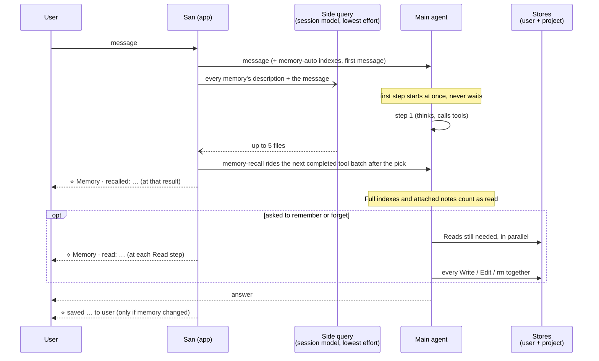

# Auto memory

Besides the user-authored AGENTS.md (see
[Context Management](../reference/context-management.md#reminders-and-hot-reload)), the main agent keeps
its own memory: facts, preferences and decisions it should still know in the
next conversation. It is on by default.

## Stores

Memory lives in two stores:

- the **user store** `~/.san/memory/`, for what holds in every repository;
- a **project store** per repository at `~/.san/projects/<encoded-main-repo-root>/memory/`.
  Subdirectories and linked worktrees share it; `AGENTS.md` is still read from the active checkout.

When enabled, a `memory-auto` reminder carries a short guide and the two store
paths, even before any notes exist. Neither the guide nor the paths are part of
the system prompt.

Each store holds:

- `MEMORY.md` is an index: one short link and reason per topic. The `memory-auto`
  reminder previews up to 2 KiB of complete lines per store; the full index and
  notes stay on disk. Index diagnostics are reported separately from the preview.
- One file per memory, with `name` / `description` / `type` frontmatter,
  dated by its file's mtime. San never rewrites a file the agent wrote. The
  category lives in `type`, not the file name: two feedback memories are two
  files, each named for its content (`concise-comments.md`).

  | `type` | Holds | Notes |
  |---|---|---|
  | `user` | who the user is: role, expertise, preferences | changes slowly |
  | `feedback` | corrections and confirmed approaches | body adds **Why:** / **How to apply:** |
  | `project` | ongoing work, decisions, deadlines not in code or git | absolute dates; goes stale fastest |
  | `reference` | where outside information lives | trackers, dashboards, docs |

  Only the model reads `type`; the harness treats all four alike.

## One message's path



## Recall

Recall puts the memories a message needs in front of the agent without
making the turn wait for them.

### When it runs

A pick starts when a **user's message** goes to the agent:

- a message typed and sent, queued, or sent mid-turn;
- a skill or slash-command prompt, a scheduled (`/loop`, cron) prompt, an
  autopilot continuation;
- the prompt of a headless `san -p` run.

Nothing else starts one: not harness messages (notices, background agent
results, a Stop hook's block, an async hook's continuation), not tool results
or later steps of the same turn, not compaction, resume or a model switch, and
not subagents, which load no memory. An empty message, or one sent while auto
memory is off, starts none either. A newer user message replaces the running
pick, which is cancelled.

### How it runs

The pick is one side query beside the turn, not a second conversation:

| | Main agent | Pick |
|---|---|---|
| Runs as | the session: history, tools, many steps | one `llm.Complete` call in a goroutine |
| Sees | the whole conversation and the indexes | one text block of `<store>/<file>` and `description` candidates, then a separate block with the user query |
| Returns | the answer | `{"selected_memories": [...]}`, up to 5 files |
| Model | session model, its usual effort | session model, its lightest reasoning rung |

The pick is told that a user memory holds everywhere and a project memory in
the current repository, and to choose only memories that bear on what the
message asks, not ones that share a word with it or describe the user in
general. It returns nothing when none does. It gives up after a minute.

### Where it lands

The main agent never waits for the pick. It starts with the task's normal
checks rather than proactively reading memory files; an explicit Read is a
fallback for necessary information recall has not supplied, or for maintaining
memory. The result filter checks for a ready pick at each tool batch's end:

| When | What happens |
|---|---|
| A tool batch finishes before the pick lands | results go back unchanged; the next batch checks again |
| The pick lands, then a tool batch finishes | the picked memories ride the last completing result as the `memory-recall` reminder |
| The agent Reads a memory before recall attaches | that memory is skipped, including reads in the same parallel batch |
| The turn calls no tool | the pick is dropped at turn end; the agent still has the indexes to Read from |

Parallel tools already finish before the next inference, so attaching at the
batch boundary adds no model wait and lets every Read register before deduplication.

Each pick attaches once. Every attached memory counts as read, so the agent
can edit it without a Read, and shows the date of its file's last change. The
reminder is part of the result the model sees, not of the result on screen.

Within a conversation an attached memory is not offered again. `/clear` and
compaction start that list over, since the memory has left the context; a
resumed session starts it over too.

`Memory · recalled` names memories the pick attached; `Memory · read` names
ones the agent Read itself. Both appear at the step that consumed them, not
under the final answer. Necessary explicit reads still work when recall is
late or misses a memory.

For automatic recall, the SDK's `ToolEnd` contains the original tool output;
the recall filter runs afterward. The UI therefore uses the subsequent
`MessageAdded` tool-result event to append a display-only recall notice before
the next inference. The notice captures the titles and pins itself to the
receiving native result's message ID, rather than the writer's latest message
(which may already be a later answer). It persists separately, so resume keeps
its placement without exposing or duplicating reminder bodies.

## Saving and forgetting

The indexes and attached memories count as read, so the agent edits them
without a Read first. The `memory-auto` reminder explains what to save and in which store. Where practical,
batch the reads still needed, then batch the writes and edits.

Writes to `*.md` inside either store need no approval in any mode, headless
(`san -p`) and don't-ask included; deny rules still apply. Forgetting is a
plain `rm` of memory files (at most `-f`, literal paths, nothing chained),
also unprompted; anything wider asks.

The agent saves during the turn, when asked or when it learns something worth
keeping; there is no background extraction pass.

## On screen

Memory consumption is shown where it happens, rather than as an unexplained
footer after the answer:

```
● I'll check the commit convention first.

⟡ Memory · read: Sign off PR commits

● Bash(git status)
  └ working tree clean

● The PR is ready.
```

All memory operations share the same `⟡` marker, including saving, updating
and forgetting. The marker gently breathes while an explicit read is running
and becomes static when it succeeds. Only the marker changes tone; the label and title do
not flash. Automatic recall uses `⟡ Memory · recalled: <title>` next to the tool
result that delivered it. Titles wrap under the label on narrow terminals;
compact notices show neither the raw file path nor the private memory body.
ctrl+o still exposes the actual calls and results, and a failed Read shows its
error instead of claiming the memory was read. Index-only reads remain quiet.
A memory-only read step keeps its thinking and its contextual read notice.

Saving, updating and forgetting still end with one quiet change summary under
the answer, grouped by verb and naming each write's store:

```
● 记住了：这个项目用 pnpm，不用 npm。
  ⟡ saved Pnpm not npm to project
```

There is one change entry per memory (a write outranks a read), and `forgot`
for one the turn touched that is gone by its end. Reads and recalls are not
repeated in this summary; a read-only turn gets no footer or empty notice.

## Settings

`/memory` toggles auto memory for all projects (`t`, or `/memory on|off`) or
for this project (`p`, or `/memory on|off project`), writing `autoMemory` to
the user or project settings; the project value wins, and
`SAN_DISABLE_AUTO_MEMORY=1` beats both. A toggle applies from the next TUI turn.
When off, San injects no auto-memory guide, paths, or previews and starts no recall.
An existing conversation gets a withdrawal rather than rewriting old messages.
User and project `AGENTS.md` still apply.

`autoMemoryDirectory` (absolute or `~/` path) moves the store of the file that
sets it: `~/.san/settings.json` the user store, an untracked
`.san/settings.local.json` the project store. Committed project settings never
count, since memory writes need no approval. `/memory` lists each store on its
own row with its directory; `d` there changes the selected store's directory,
writing the setting to the right file (empty restores the default) and moving
its memories along unless the new directory already holds some.

## Scope

Subagents don't load either store. Skills are separate: `/evolve` reviews
turns and edits skills, never memory.

## Design choices

- **Recall never holds up the turn.** The pick takes 2–10 s on a reasoning
  model; waiting for it would add that to every turn. Normal task tools give
  recall time to land without an extra memory-read step; necessary missing
  information can still be read explicitly. Recall attaches when the tool
  batch finishes, before the model's next step.
- **The pick is a side query, not a forked conversation.** Choosing from
  descriptions needs only the message, so a one-shot call does it and leaves
  the main conversation, its context and its prompt cache untouched.
- **Only the user's messages start a pick.** They carry the intent memory
  should serve. A harness message (notice, hook) would waste a call, and
  mid-turn it would cancel the pick the user's message started.
- **Indexes always, bodies on demand.** The capped indexes tell the agent what
  exists at a fixed cost; a memory's body enters the context only when a pick
  or the agent wants it.
- **Memory work takes two responses.** Indexes and attached memories count as
  read, so the agent edits them directly: Reads still needed first, then all
  writes together. "Remember X" went from about 25 s to 12 s.
- **Two stores.** Some facts hold everywhere (who the user is), others in one
  repository (its freeze, its conventions); one store would mix repositories.
  The project store is keyed by the repository root, so subdirectories and
  worktrees share it. Committed project settings cannot move a store, since
  memory writes need no approval.
- **San never edits what the agent wrote.** A `modified` stamp once changed
  files under the agent and broke its next Edit; the file's mtime dates a
  memory instead.
- **No per-write checks.** A step's writes land together, so checking each one
  fired between them; index problems go into the next index reminder.
- **No background extraction.** The agent saves during the turn, when asked or
  when it learns something worth keeping. A separate pass after the turn would
  need its own fork, cursor and conflict rules with the main agent.
- **Consumption is contextual; bookkeeping stays quiet.** A compact read or
  recall notice belongs at the step that consumed the memory, not under an
  unrelated final answer. Only saves, updates and forgetting keep a turn-end
  summary. What already showed (a step's thinking) stays, since taking it back
  flashes.

## Tests

```bash
go test ./internal/agent ./internal/core/system ./internal/app/conv ./internal/app ./internal/app/kit
```

- `internal/agent/memory_recall_test.go`: selection, one-shot delivery and
  deduplication after parallel memory reads.
- `internal/app/conv/memory_read_test.go`: placement among sibling tools,
  memory-only steps, breathing/static markers, expansion, failure, recall
  delivery, narrow-terminal wrapping and replay without the original file.
- `internal/app/memory_read_test.go`: SDK event ordering through scrollback
  commit, persisted recall notices and no duplicated turn-end footer.
- `internal/app/memory_test.go` and `internal/app/conv/memory_render_test.go`:
  memory permissions, operation recognition and change-summary bookkeeping.

## See Also

- [Context Management](../reference/context-management.md) — reminders and the
  AGENTS.md memory beside this one.
- [`packages/reminder.md`](../packages/reminder.md) — the
  `memory-auto` and `memory-recall` sources.
