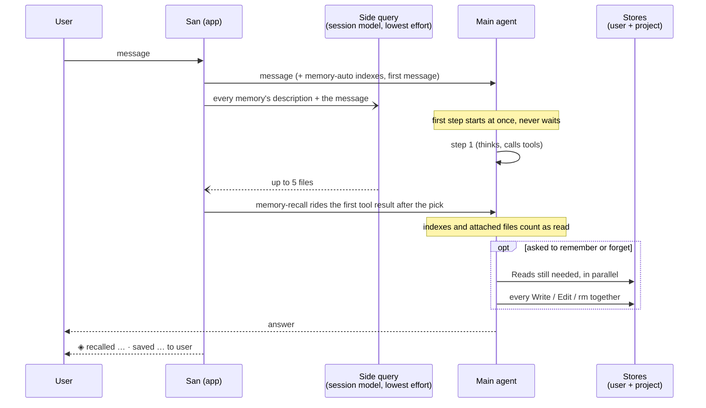

# Auto memory

Besides the user-authored AGENTS.md (see
[harness channels](harness-channels.md#memory-agentsmd)), the main agent keeps
its own memory: facts, preferences and decisions it should still know in the
next conversation. It is on by default.

## Stores

Memory lives in two stores:

- the **user store** `~/.san/memory/`, for what holds in every repository;
- a **project store** per repository at `~/.san/projects/<repo-root>/memory/`
  (subdirectories and linked worktrees share it).

The prompt tells the model which store each memory belongs in; the project
store wins on conflict. Both directories are created up front, and an empty
store shows in the reminder as `(no memories yet)`, so the agent neither runs
`mkdir` nor reads a missing index.

Each store holds:

- `MEMORY.md`, an index with one line per memory. Each store's first 200
  lines / 25 KB ride the `memory-auto` reminder, framed as context rather than
  user instructions. Index problems (near or over the cap, unindexed topic
  files, links to missing files, a memory in both stores) are appended so the
  agent repairs them.
- One file per memory, with `name` / `description` / `type` frontmatter,
  dated by its file's mtime. San never rewrites a file the agent wrote. The
  category lives in `type`, not the file name: two feedback memories are two
  files, each named for its content (`concise-comments.md`).

  | `type` | Holds | Notes |
  |---|---|---|
  | `user` | who the user is: role, expertise, preferences | changes slowly |
  | `feedback` | corrections and confirmed approaches | body adds **Why:** / **How to apply:** |
  | `project` | ongoing work, decisions, deadlines not in code or git | absolute dates; goes stale fastest |
  | `reference` | where outside information lives | trackers, dashboards, docs |

  Only the model reads `type`; the harness treats all four alike.

## One message's path



## Recall

When a message goes to the agent, a side query to the session model (its
lightest reasoning rung) picks up to five memories whose `description` bears on
it. The turn never waits: the pick's contents ride the `memory-recall`
reminder on the first tool result that completes after it lands, and a turn
that calls no tool goes without (the indexes are still there to Read from).

A memory is attached once per conversation, and not at all when the agent
already has the file in view. The reminder is hidden from the tool result on
screen.

## Saving and forgetting

The indexes and attached memories count as read, so the agent edits them
without a Read first. The `memory` rules section tells it what to save and in
which store, and to do memory work in at most two responses: the Reads it
still needs, then every Write, Edit and `rm` together. Writes are not checked
one by one, since a step's writes land together.

Writes to `*.md` inside either store need no approval in any mode, headless
(`san -p`) and don't-ask included; deny rules still apply. Forgetting is a
plain `rm` of memory files (at most `-f`, literal paths, nothing chained),
also unprompted; anything wider asks.

The agent saves during the turn, when asked or when it learns something worth
keeping; there is no background extraction pass.

## On screen

Memory stays out of the chat flow. A step that only touched memory draws its
thinking but not its calls: the thinking was on screen before the calls
arrived, and taking it back would flash.

Each turn that touched memory ends with one quiet line under the answer, by
index title, grouped by verb:

```
● 记住了：这个项目用 pnpm，不用 npm。
  ◈ recalled Release freeze · saved Pnpm not npm to project
```

`◇` marks a turn that only read memory, `◈` one that changed it. There is one
entry per memory (a write outranks a read, and names its store), and `forgot`
for one the turn touched that is gone by its end. ctrl+o shows the calls
themselves; a failed call always does.

## Settings

`/memory` toggles auto memory for all projects (`t`, or `/memory on|off`) or
for this project (`p`, or `/memory on|off project`), writing `autoMemory` to
the user or project settings; the project value wins, and
`SAN_DISABLE_AUTO_MEMORY=1` beats both. A toggle applies from the next turn;
moving a store or turning memory off mid-session re-sends the index reminder
(or an "auto memory is now off" notice), since the one sent at session start
names the old state.

`autoMemoryDirectory` (absolute or `~/` path) moves the store of the file that
sets it: `~/.san/settings.json` the user store, an untracked
`.san/settings.local.json` the project store. Committed project settings never
count, since memory writes need no approval. `/memory` lists each store on its
own row with its directory; `d` there changes the selected store's directory,
writing the setting to the right file (empty restores the default) and moving
its memories along unless the new directory already holds some.

## Scope

Subagents don't load either store. Skills are separate: `/evolve` reviews
turns and edits skills, never memory.

## See Also

- [`concepts/harness-channels.md`](harness-channels.md) — reminders and the
  AGENTS.md memory beside this one.
- [`packages/reminder.md`](../packages/2-feature/reminder.md) — the
  `memory-auto` and `memory-recall` sources.
