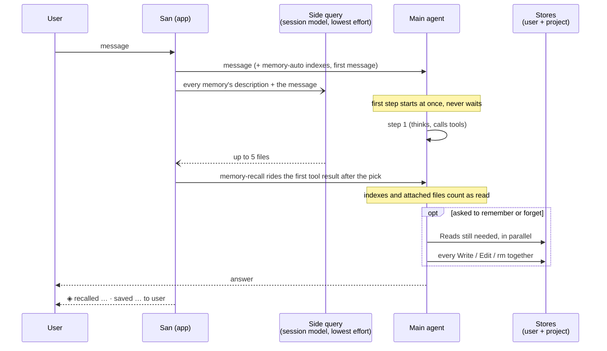

# Auto memory

Besides the user-authored AGENTS.md (see
[harness channels](harness-channels.md#memory-agentsmd)), the main agent keeps
its own memory: facts, preferences and decisions it should still know in the
next conversation. It is on by default.

## Stores

Memory lives in two stores:

- the **user store** `~/.san/memory/`, for what holds in every repository;
- a **project store** per repository at `~/.san/projects/<repo-root>/memory/`
  (subdirectories and linked worktrees share it).

The prompt tells the model which store each memory belongs in; the project
store wins on conflict. Both directories are created up front, and an empty
store shows in the reminder as `(no memories yet)`, so the agent neither runs
`mkdir` nor reads a missing index.

Each store holds:

- `MEMORY.md`, an index with one line per memory. Each store's first 200
  lines / 25 KB ride the `memory-auto` reminder, framed as context rather than
  user instructions. Index problems (near or over the cap, unindexed topic
  files, links to missing files, a memory in both stores) are appended so the
  agent repairs them.
- One file per memory, with `name` / `description` / `type` frontmatter,
  dated by its file's mtime. San never rewrites a file the agent wrote. The
  category lives in `type`, not the file name: two feedback memories are two
  files, each named for its content (`concise-comments.md`).

  | `type` | Holds | Notes |
  |---|---|---|
  | `user` | who the user is: role, expertise, preferences | changes slowly |
  | `feedback` | corrections and confirmed approaches | body adds **Why:** / **How to apply:** |
  | `project` | ongoing work, decisions, deadlines not in code or git | absolute dates; goes stale fastest |
  | `reference` | where outside information lives | trackers, dashboards, docs |

  Only the model reads `type`; the harness treats all four alike.

## One message's path



## Recall

Recall puts the memories a message needs in front of the agent without
making the turn wait for them.

### When it runs

A pick starts when a **user's message** goes to the agent:

- a message typed and sent, queued, or sent mid-turn;
- a skill or slash-command prompt, a scheduled (`/loop`, cron) prompt, an
  autopilot continuation;
- the prompt of a headless `san -p` run.

Nothing else starts one: not harness messages (notices, background agent
results, a Stop hook's block, an async hook's continuation), not tool results
or later steps of the same turn, not compaction, resume or a model switch, and
not subagents, which load no memory. An empty message, or one sent while auto
memory is off, starts none either. A newer user message replaces the running
pick, which is cancelled.

### How it runs

The pick is one side query beside the turn, not a second conversation:

| | Main agent | Pick |
|---|---|---|
| Runs as | the session: history, tools, many steps | one `llm.Complete` call in a goroutine |
| Sees | the whole conversation and the indexes | each memory's `<store>/<file>` and `description`, and the message |
| Returns | the answer | `{"selected_memories": [...]}`, up to 5 files |
| Model | session model, its usual effort | session model, its lightest reasoning rung |

The pick is told that a user memory holds everywhere and a project memory in
the current repository, and to choose only memories that bear on what the
message asks, not ones that share a word with it or describe the user in
general. It returns nothing when none does. It gives up after a minute.

### Where it lands

The main agent never waits for the pick and never knows it is running. Each
tool result passes the result filter on its way back to the model; the filter
checks, without blocking, whether the pick has landed:

| When | What happens |
|---|---|
| A tool result returns before the pick lands | it goes back unchanged; the next result checks again |
| The pick lands, then a tool result returns | the picked memories ride that result as the `memory-recall` reminder |
| The agent Reads a memory before the pick lands | that memory is skipped when the pick attaches: never in context twice |
| The turn calls no tool | the pick is dropped at turn end; the agent still has the indexes to Read from |

Each pick attaches once. Every attached memory counts as read, so the agent
can edit it without a Read, and shows the date of its file's last change. The
reminder is part of the result the model sees, not of the result on screen.

Within a conversation an attached memory is not offered again. `/clear` and
compaction start that list over, since the memory has left the context; a
resumed session starts it over too.

On the turn's memory line, `recalled` names memories the pick attached and
`used` those the agent Read itself. A slow pick mostly shows as `used`: the
agent found the memory in the index first.

## Saving and forgetting

The indexes and attached memories count as read, so the agent edits them
without a Read first. The `memory` rules section tells it what to save and in
which store, and to do memory work in at most two responses: the Reads it
still needs, then every Write, Edit and `rm` together. Writes are not checked
one by one, since a step's writes land together.

Writes to `*.md` inside either store need no approval in any mode, headless
(`san -p`) and don't-ask included; deny rules still apply. Forgetting is a
plain `rm` of memory files (at most `-f`, literal paths, nothing chained),
also unprompted; anything wider asks.

The agent saves during the turn, when asked or when it learns something worth
keeping; there is no background extraction pass.

## On screen

Memory stays out of the chat flow. A step that only touched memory draws its
thinking but not its calls: the thinking was on screen before the calls
arrived, and taking it back would flash.

Each turn that touched memory ends with one quiet line under the answer, by
index title, grouped by verb:

```
● 记住了：这个项目用 pnpm，不用 npm。
  ◈ recalled Release freeze · saved Pnpm not npm to project
```

`◇` marks a turn that only read memory, `◈` one that changed it. There is one
entry per memory (a write outranks a read, and names its store), and `forgot`
for one the turn touched that is gone by its end. ctrl+o shows the calls
themselves; a failed call always does.

## Settings

`/memory` toggles auto memory for all projects (`t`, or `/memory on|off`) or
for this project (`p`, or `/memory on|off project`), writing `autoMemory` to
the user or project settings; the project value wins, and
`SAN_DISABLE_AUTO_MEMORY=1` beats both. A toggle applies from the next turn;
moving a store or turning memory off mid-session re-sends the index reminder
(or an "auto memory is now off" notice), since the one sent at session start
names the old state.

`autoMemoryDirectory` (absolute or `~/` path) moves the store of the file that
sets it: `~/.san/settings.json` the user store, an untracked
`.san/settings.local.json` the project store. Committed project settings never
count, since memory writes need no approval. `/memory` lists each store on its
own row with its directory; `d` there changes the selected store's directory,
writing the setting to the right file (empty restores the default) and moving
its memories along unless the new directory already holds some.

## Scope

Subagents don't load either store. Skills are separate: `/evolve` reviews
turns and edits skills, never memory.

## Design choices

- **Recall never holds up the turn.** The pick takes 2–10 s on a reasoning
  model; waiting for it would add that to every turn. Not waiting costs at
  most one step: the agent Reads the memory from the index itself. A tool
  result is the earliest place the pick can join without delaying anything,
  since it is the next thing the model reads after its first step.
- **The pick is a side query, not a forked conversation.** Choosing from
  descriptions needs only the message, so a one-shot call does it and leaves
  the main conversation, its context and its prompt cache untouched.
- **Only the user's messages start a pick.** They carry the intent memory
  should serve. A harness message (notice, hook) would waste a call, and
  mid-turn it would cancel the pick the user's message started.
- **Indexes always, bodies on demand.** The capped indexes tell the agent what
  exists at a fixed cost; a memory's body enters the context only when a pick
  or the agent wants it.
- **Memory work takes two responses.** Indexes and attached memories count as
  read, so the agent edits them directly: Reads still needed first, then all
  writes together. "Remember X" went from about 25 s to 12 s.
- **Two stores.** Some facts hold everywhere (who the user is), others in one
  repository (its freeze, its conventions); one store would mix repositories.
  The project store is keyed by the repository root, so subdirectories and
  worktrees share it. Committed project settings cannot move a store, since
  memory writes need no approval.
- **San never edits what the agent wrote.** A `modified` stamp once changed
  files under the agent and broke its next Edit; the file's mtime dates a
  memory instead.
- **No per-write checks.** A step's writes land together, so checking each one
  fired between them; index problems go into the next index reminder.
- **No background extraction.** The agent saves during the turn, when asked or
  when it learns something worth keeping. A separate pass after the turn would
  need its own fork, cursor and conflict rules with the main agent.
- **Out of the chat flow.** Memory bookkeeping is not the user's work, so its
  calls don't draw and the turn ends with one line. What already showed (a
  step's thinking) stays, since taking it back flashes.

## See Also

- [`concepts/harness-channels.md`](harness-channels.md) — reminders and the
  AGENTS.md memory beside this one.
- [`packages/reminder.md`](../packages/2-feature/reminder.md) — the
  `memory-auto` and `memory-recall` sources.
