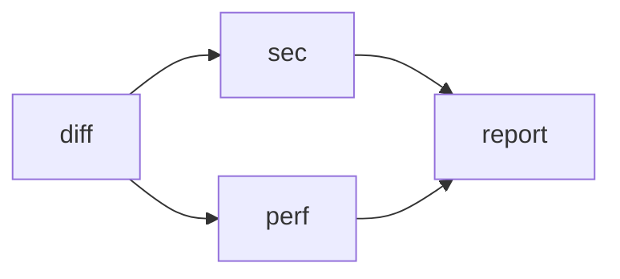
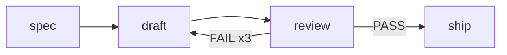

# Flow

A Flow is a collaboration blueprint for subagents: which step depends on which,
which can run together, and which route an answer selects. The scheduler runs
that blueprint through the existing Agent executor and task infrastructure; it
is not another Agent or a separate permission/session system.

Definitions are markdown documents saved under `.san/workflows/`. The existing
storage directories are retained so saved definitions and runs remain available.
`/flow` calls the scheduling service directly: there is no model-facing Flow
tool or schema. San validates the graph before execution and reports its outcome
as one parent task.

Use a Flow when the arrangement matters more than any single job — a
dependency order a long turn could forget, or a fan-out whose intermediate
results should stay out of the main conversation. For one bounded job, or a
one-off fan-out, the `Agent` tool is still the right call.

## The definition

````markdown
---
name: review
max_parallel: 4
---



## diff
mode: explore

Summarize {{input.base}}..HEAD by package

## sec
mode: explore

Security only: {{diff}}

## perf
mode: explore

Performance regressions only: {{diff}}

## report
Merge into one review: {{sec}} {{perf}}
````

| Part | Rule |
| --- | --- |
| frontmatter | optional: `name`, `description`, `max_parallel` (default 4) |
| mermaid block | the only source of topology. Starts with `flowchart LR`; then bare ids joined by `-->` (sequence), `&` (fan-out and fan-in), `-->\|LABEL\|` (conditional) and `-->\|LABEL xN\|` pointing back at an ancestor (a bounded retry; see below). Node shapes, subgraphs and other mermaid syntax are errors, not silently ignored — a dropped edge is a silently wrong graph. |
| `## id` | one node, one agent turn. Every id in the graph needs a section and vice versa. |
| `key: value` under the heading | the contiguous run of such lines is config: `executor`, `agent`, `mode` (`explore`, `edit`, `default`), `model`, `continue_on_error`. Everything after them is the prompt. An unknown key is an error; put a blank line before prompt text that happens to start with `word:`. |
| `executor:` | `subagent` by default. Explicit `main` uses the current main conversation for a final join or bounded-loop writer; see below. |
| `agent:` | the name of a definition in `.san/agents/`, which is where a node gets its tool list, skills, system prompt and MCP servers. A name that resolves to nothing is refused before the run starts — in a file, an unknown name is a typo, not a label. Leave the line out for the default agent. |
| `{{id}}` | the complete final answer text of an upstream node, inserted into this node's prompt. Any ancestor on a taken path counts, not only the direct parent. Referencing a node with no path here is a validation error. |
| `{{input}}` | the simple run parameter, supplied as `input=value`. |
| `{{input.key}}` | an author-defined named parameter, collected before launch or supplied as `key=value`. |
| `for_each` + `max_workers` | fans this node out over a plan; see below. |

By default each node is a fresh subagent with no memory of the others; brief it
fully, the way an `Agent` prompt is briefed. An explicit `executor: main` node
instead uses the current main conversation and its existing context.

### Inputs and step answers

`{{input}}` is the simple run input: enter its value in the run form or pass
`input="review storage"` on `/flow run`. Named parameters still use
`{{input.topic}}`, supplied as `topic="review storage"`. `{{input.task}}` is an
ordinary parameter named `task`, not a built-in task object. Bare `{{input}}`
and `{{input.input}}` use the same key. For compatibility, a node actually named
`input` keeps its existing node-output meaning for bare `{{input}}`.

`{{work}}` means “insert the complete final answer from the step whose ID is
`work`.” It comes from `## work`, not an agent name or a user input. A graph
edge determines when a step may run; template references determine which
answer text it receives. Each ordinary node invokes a fresh subagent; a
`for_each` node invokes one per plan item.

Ordinary step answers are text, not objects with automatic `{{work.field}}`
access. The separate `for_each: plan.tasks` setting can select an array field
from a step's JSON answer; its workers use `{{item}}` or `{{item.key}}` as
explained below.

## Saved blueprints

Definitions live in `.san/workflows/*.md` (project) and
`~/.san/workflows/*.md` (user); the project copy wins when both define the
same name, and the `name:` in frontmatter beats the filename. Saved names and
input keys are completed using the same quoted-argument rules as execution.
`/flow show <name>` previews the graph, step prompts and input keys without
starting a task. In the TUI, `/flow run <name>` opens a guided form for missing
inputs; supplying every required value launches directly.

`/flow` opens a hub with **Create a flow**, saved blueprints and recent runs.
Choose Create a flow to describe a goal without remembering command syntax.
The main action appears directly below each page title; secondary shortcuts
stay in the footer:

```text
Describe → Review → Save → Run
```

Management is explicit and does not inject authoring instructions into ordinary
model turns. A subcommand is recognized only in its exact shape (`edit` takes one name,
`run` takes a saved name or `key=value` inputs, and so on); anything else is a
goal, so `/flow run the tests and fix failures` drafts a blueprint:

| Command | Action |
| --- | --- |
| `/flow <goal>` | Generate a blueprint for Review from a natural-language goal. Never saves or runs automatically. |
| `/flow new [name]` | Open a one-step manual draft in Review; no review agent is added automatically. |
| `/flow from-skill <skill> [name]` | Create a one-node draft referencing an enabled Skill; review before saving. The Skill remains unchanged and its live instructions/resources are loaded when the node runs. No automatic splitting is attempted. |
| `/flow edit <name>` | Review or edit a saved definition. |
| `/flow show <name>` | Preview a saved definition without starting it. |
| `/flow inspect <run-id\|task-id>` | Inspect a running or previous execution. |
| `/flow stop [run-id\|task-id]` | Stop one flow, or name it when several run. |
| `/flow list` | Print the saved definitions. |
| `/flow run <name> [key=value …]` | Run a saved blueprint; missing inputs open a guided form in the TUI. No model turn. |

Review keeps the dependency graph above one selected step. `↑`/`↓` walks through
steps; the detail shows the agent configuration, each inserted input's source,
the output's consumers, and the instructions. Scrolling the instructions does not hide the graph.
Enter follows the visible action: save the draft, confirm the save preview,
then prepare the saved blueprint for running. Saving never launches a run.
`e` edits source, `Ctrl+S` previews changes, and the existing `s`, `y`, and `r`
shortcuts remain available.

For example, `/flow Check this package's security and performance, then combine
the findings` starts one drafting request from the current conversation. The
blueprint guide and enabled agent/Skill discovery metadata are loaded only for
that request. It advertises no tools, executes no commands, and adds neither its
guide nor its reply to the main Agent's ordinary conversation context. The call
is recorded under the session's `flow` inference purpose. While waiting, the
Create Flow page shows a breathing dot and elapsed time; it switches to Review
when the response completes.

The model proposes the smallest useful topology: real dependencies form chains,
independent work can run in parallel, and dynamic workers or evaluator loops
need explicit bounds. It does not carry out the goal. Concrete goal details stay
in the instructions rather than becoming redundant run parameters; inputs are
for missing or deliberately reusable values. A manual `/flow new` starter
remains a one-step editable blank, not a task-specific plan.

Only a normally completed draft opens as an unsaved Review. Invalid source is
retained for manual repair; there is no automatic repair loop. Token truncation,
refusal or an unexpected stop reason is a visible generation failure, not a
Review, and requires an explicit retry. Escape cancels drafting, and late results
from a closed/replaced view or another session cannot reopen it. Saving and running remain separate
choices. Reserved management verbs take priority; `/flow <name>` is no longer a
run shortcut—use `/flow run <name>`.

`d` opens execution limits rather than mixing them into the main review. These
count step executions (including bounded workers and rounds), not individual
model calls, tokens or cost. `max_parallel` is only a ceiling; dependencies
still determine which steps can run together. The one-step starter uses 1.

Existing user definitions become project copies; their source is not
overwritten. A changed on-disk source must be reopened rather than silently
replaced. `r` on a saved review collects any required values in the same form as
`/flow run <name>`. Enter or Tab advances; Shift+Tab goes back, Shift+Enter adds
a newline, and Escape returns to Review without losing edits. A final summary
shows the values before Enter starts the run. No tasks start while filling in
the form. Short field labels replace template syntax in this view.

Full command arguments remain an optional shortcut and support quoted spaces:
`/flow run review base="main branch"`. Saved names with spaces are quoted too,
for example `/flow run "release review" base=main`.

The task area (Alt+T) shows Flow's animated dependency graph alongside ordinary
tasks. Headings use readable names, such as `Readonly review · 0/5 steps`, without
changing saved identifiers. Counts show settled steps, not acceptance of results.
Native subagents keep their own progress and output. `/flow stop` bypasses
a foreground response's input queue; its notice waits for that response's
conversation tail. With an empty input, Ctrl+C interrupts a foreground response
first, otherwise stops the sole running Flow or lists IDs when several run.
With no running Flow, the existing double Ctrl+C exit remains unchanged.

A file is parsed when reviewed or run, not at startup: a broken definition
never blocks the session.

### Try a full repository audit

[`examples/flows/ponytail-audit.md`](../../examples/flows/ponytail-audit.md)
preserves the original `ponytail-audit` instructions in a read-only flow.
It keeps all six check categories, the evidence rules, the report format and
its example. The instructions are split into five subagent turns:

- `inspect`: the original audit priorities and **1. Map first**. Establish
  the scope, assumed load, entry points and main data flows; hand off source
  evidence, tests and unread areas.
- `correctness`: original checks **1. Bug** and **4. Missing test**.
- `security`: original checks **2. Risk** and **3. Scale**, including data
  loss and failures at the expected load.
- `maintenance`: original checks **5. Speed** and **6. Lean**, including all
  six lean checks: delete, reuse, stdlib / native, yagni, merge and split.
- `report`: the complete **3. Check before you report** and **4. Output**.
  Collect candidates, re-read evidence, confirm concrete triggers,
  search all references before declaring code unused, deduplicate and rank.
  Write the full report in the original simple-English format, including the
  three groups, continuous numbering, four parts per finding, verdict, lean
  totals and unexamined areas.

The three checks run in parallel after `inspect`; `report` waits for all three.
Verification and report writing share one node, avoiding another agent call
and handoff. Every node runs in `explore` mode and changes no code.

Five nodes do not mean five full repository scans. The first node surveys the
repository and passes focused source evidence to the three checks. They reuse
that evidence and read more where needed. The checks are separate reviews of
the requested scope, not three reviews launched for every file read. The
`report` node verifies candidates, including whole-tree reference searches
for unused code, then writes the report. These are prompt instructions, not
enforced read limits.
Nodes have separate conversations and receive upstream output text, not its
full tool history. Each parallel check receives the same repository context,
and overlapping reads remain possible; both can add token cost. The original
skill keeps its work in one agent context and can also re-read files to verify
a finding; it does not promise exactly one scan.

This example demonstrates parallel review, evidence handoff and verification.
It is not the cheapest way to audit a repository, and parallel execution does
not guarantee a speedup. For a quick first run, scope it to a small package.
A review of changed files, split into non-overlapping file groups, is a more
bounded demonstration of distributing work; this audit deliberately keeps
the original whole-repository checks.

To install the self-contained example:

```bash
mkdir -p .san/workflows
cp examples/flows/ponytail-audit.md .san/workflows/ponytail-audit.md
```

In the TUI, use `/flow show ponytail-audit` to inspect the structure,
then `/flow run ponytail-audit scope=.` for the whole repository, or
`scope=internal/flow` for one package. The task view names each stage by
its job, so the initial inspection, concurrent checks and final report are
visible. The task log keeps their full tool activity. The example embeds its
prompts; installing a separate Ponytail skill is not required.

## Fanning out over a plan

A node with `for_each` runs once per item of a plan an upstream node
produced, which is how one flow splits work it could not know in advance:

````markdown
## plan
Split the review into non-overlapping tasks, at most 8, as JSON:
{"tasks":[{"name":"llm","prompt":"Review error handling in internal/llm"}]}

## review
for_each: plan.tasks
max_workers: 8
agent: Explore
mode: explore

{{item.prompt}}

## merge
Merge: {{review}}
````

- `for_each: plan.tasks` reads the first JSON value in `plan`'s output and
  takes its `tasks` field; `for_each: plan` uses the whole value. It must be
  a non-empty array.
- Items may be strings (`{{item}}`) or objects (`{{item.key}}`, and
  `{{item}}` for the whole object). An item's `name` field labels its
  worker; without one the label is its position.
- **`max_workers` is required.** A plan with more items than that is refused
  rather than truncated — so say the same limit in the planning node's
  prompt. This is what makes the worst case knowable before launch, which is
  the only reason dynamic fan-out is allowed at all.
- The two bounds do different jobs: `max_workers` caps how many workers a
  plan may *ask for* (a larger plan is refused), while `max_parallel` caps
  how many turns are *in flight* across the whole run. Workers queue for the
  run's slots like any other node.
- Downstream sees the workers' outputs merged under `## <label>` headings.
  A worker that failed is left out rather than left as an empty heading.
- The orchestrator returns a plan; it does not call the workers. They are
  ordinary nodes, each through the same permission gate with its own
  transcript, so nothing recurses.

The saved-definition preview reports the worst-case bound, for example
`up to 14 turns` and `review: up to 8 workers over plan.tasks`. Launch validates
the definition, agent selections and required inputs; there is no whole-Flow
approval dialog. Native child permissions remain unchanged.

## Drafting until a review passes

A conditional edge pointing back at an ancestor is a retry, and it must say
how many:

````markdown


## draft
Write it. Previous review: {{review}}

Spec: {{spec}}

## review
PASS or FAIL: {{draft}}

## ship
Ship {{draft}}
````

Parsing unrolls this into a plain chain — `draft#1 → review#1 ─FAIL→ draft#2
→ …`, with a `PASS` escape from every round to `ship` — so the scheduler,
the permission gate and the summary never learn that a loop existed. What
follows falls out of that:

| Case | Behaviour |
| --- | --- |
| `{{review}}` inside `draft` | the previous round's review; empty on the first |
| `{{draft}}` inside `ship` | the round that actually passed |
| an early round passing | the remaining rounds are omitted, never run |
| every round used up, still `FAIL` | the flow **fails** — the condition was never met, and a result that failed review must not flow on |
| `review` answering neither `FAIL` nor `PASS` | that round **fails**, in any round. The node carrying the back edge is the one place every answer is declared (the retry label plus the escapes), so an answer outside them is a model gone off-script, not a quiet stop. Any other node — a gate outside the loop or inside its body — keeps gate semantics: an unmatched `NO` means "stop here" and succeeds |
| the bound | required, from `x1` to `x10`. A back edge without `xN` is the cycle error it would otherwise be. The cap is checked during parsing before anything is unrolled, including during Review and launch validation |
| one loop after another | the second is always entered at its first round, however many rounds the first one took |
| the target | must be an ancestor of the source, or there is no loop to bound |
| a node in two loops, or `for_each` inside one | rejected: rounds × rounds and dynamic × iteration are both cartesian explosions |
| an edge into the body from outside | rejected — route it through the loop's head, or a later round would re-read a node that ran once |

The point of splitting `draft` from `review` is that the review runs in a
clean context instead of grading what it just wrote. The worst-case execution
bound counts every round, and the saved-definition preview names the loop:
`draft/review: up to 3 rounds`. The live footer folds linear loops back into
one topology with a labeled return arrow. Fixed node positions and highlighted
active paths follow the Intro's graph presentation; retry labels count actual
returns. The running node breathes, and the round and step count grow only when
another round starts, not from all possible future rounds.

## Interactive writers in the main conversation

**Subagent execution remains the default.** To opt a writer into the actual main
conversation, set `executor: main` under its heading. `executor: subagent` is the
explicit default; existing definitions need no changes. Review discloses the target.
Main execution streams and persists as a normal main Agent turn, not a copied
subagent answer or an extra summary request.

One authored node may use main: either the final global join/sink, or the head of
a bounded writer–critic loop. It inherits the current main model, permissions and
context, so it cannot override `agent`, `mode` or `model`, use `for_each`, or tolerate
failure with `continue_on_error`. Other steps remain native subagents. Only one
main-enabled Flow can own a conversation at a time; an existing main turn finishes
before its writer starts.

While a critic evaluates, ordinary user input stays in the editable input queue.
The next writer receives these amendments before its first inference, even when
it uses no tools. Accepted amendments also accompany the next critic/decision;
newly queued instructions do not change the criteria of an ongoing review. A
`PASS` with pending amendments takes the next writer round instead of ending the
Flow. The original verdict and the effective route are both checkpointed. Reaching
the round limit with pending changes fails explicitly rather than accepting the
old draft or retrying forever.

`/flow stop` cancels the run; it does not resume a partially completed critic after
the draft changes. A changed draft always gets a new assessment. Failed/interrupted
main turns require explicit rerun confirmation, even if no input identity was
saved; resuming in another conversation is refused. Undelivered queued input is
retained rather than silently starting work after cancellation.

### Try the writer–critic example

[`examples/flows/writer-critic.md`](../../examples/flows/writer-critic.md) starts
with a deliberately rough draft so the revision path is visible. The writer,
critic, exact-label decision and final result are separate steps; the loop has
three rounds total. Install without replacing an existing definition:

```bash
mkdir -p .san/workflows
cp -n examples/flows/writer-critic.md .san/workflows/writer-critic.md
```

Run `/flow edit writer-critic`, change the writer's `executor: subagent` to
`executor: main`, and save. Then run:

```text
/flow run writer-critic input="给初中生写一篇解释什么是缓存的短文"
```

While the critic is running, send a refinement such as “不要用浏览器缓存作例子，改用图书馆和书桌，并以一句总结收尾。”
It waits for the current review, then enters the next writer revision. Leaving
`executor: subagent` unchanged runs the ordinary non-interactive subagent loop.

## How it runs

While a Flow runs, its parent task displays the animated dependency graph in
the existing task area. Other Agent and Bash tasks keep their ordinary display.
Launching returns to the composer instead of automatically opening a separate
run panel. Start, graph and completion use the same neutral **Flow** label and
readable title. `Alt+T` still controls task-area visibility.

Subagent nodes execute through the native subagent executor, with its existing
model, tools, permissions and sessions. They use native Agent blocks in the
conversation: identity, elapsed time and recent activity, followed by bounded
answer previews. Main nodes use the current conversation's native turns and
history instead. On completion, Flow renders its complete final sink answer as
an independent top-level Markdown result in the main conversation, separated from
the completion receipt by a blank line, without another generated heading. A
main final sink already shown natively is not repeated. Child preview limits do
not apply. One sink returns its answer; multiple successful sinks retain labeled
sections. No inspection command is needed to read the report; empty results are
reported explicitly.
The scheduler's own start and terminal notices remain display-only: completing
a Flow does not ask the main Agent to summarize it again. Add an explicit
downstream node when synthesis is needed. Children remain background/parallel.
The footer keeps the dependency graph
without duplicate child task rows or a redundant Tasks caption. Inspecting a
node opens native task detail, not a second Flow activity viewer. Fan-out workers
and earlier attempts retain their own execution references.
An explicit Flow inspector provides graph-level stop, retry and rerun controls;
these are distinct from continuing an individual Agent conversation.

- A node starts once every upstream has settled. At most `max_parallel`
  nodes run at once.
- `a -->|HIGH| b` runs `b` only when `a`'s trimmed output equals `HIGH`. A
  node whose upstream edges were all untaken (or whose upstreams were all
  omitted themselves) is **omitted**; it never runs, and a `{{id}}` pointing
  at it renders empty. One taken edge is enough to run.
- A node sees the outputs of the ancestors reached through taken edges. An
  untaken conditional edge hides that branch: in `a -->|X| d`, `{{a}}`
  inside `d` is `a`'s output only when `a` said `X`.
- A failed node **skips** everything downstream and fails the flow.
  `continue_on_error: true` on the failing node lets downstream run and
  keeps the flow's verdict clean. What `{{id}}` then renders to depends
  on whether anything whole survived: nothing for an ordinary node, since
  its content is the half-answer it stopped on and a downstream node would
  read that as the finished thing; for a `for_each` node, the workers that
  did finish — their output is complete, there is simply less of it than the
  plan asked for.
- A node fails when its turn ends any way other than the model stopping on
  its own — step cap, truncation, refusal, cancellation, error. A model that
  stops early having done half the job reports success; a converging node
  that reviews its inputs is the guard for that.
- Every node passes the same permission gate as a background `Agent`.
  Ordinary prompts can reach the live session UI; without it they fail closed.
  A definition cannot request `bypass` — internal node `mode` accepts
  `explore`, `edit` and `default` only. A UI answer grants that invocation once,
  never overrides hard denials or changes the node's policy. What `default`
  resolves to remains the subagent layer's business, the same as for `Agent`.
  Approval and question headers name the flow, run task ID, node, and
  `for_each` worker label when present. These identify the source, not a shared
  worker address; parallel nodes keep independent replies and cancellation.
- `AgentStop` on the flow's task cancels it: nodes that have not started
  fail, running nodes are interrupted, finished outputs are kept.
- Flow is started by the user's slash command, not a model tool call; its
  nodes do not acquire another scheduling tool.

## What comes back

The run starts immediately and a start receipt appears in the conversation;
`/flow` lists the run. Its run ID or task ID works with `/flow inspect` and
`/flow stop`. When the run succeeds, a short
completion receipt is followed by a separate full report in the main conversation:
the successful sink answers (nodes with nothing downstream). The persisted run
keeps the full status summary and sink outputs. Failed runs retain diagnostics
and partial results. Each node's
transcript is saved under the session like any subagent's.

A persisted run summary looks like:

```
flow review succeeded in 1m24s
  ✓ diff (12s)
  ✓ sec (41s)
  ✓ perf (38s)
  ✓ report (27s)

## report
…
```

## Run view and recovery

The task-area graph places each status circle before its node name: filled for
completed nodes, breathing filled for genuinely running nodes, hollow before
execution.
Exceptional states remain explicit. Inspection uses a stable dependency graph,
or a dependency list on narrow screens. Manual selection stays pinned; `f`
follows active work. `Enter` selects a recorded subagent execution and opens
the existing task detail, rather than another output/activity renderer. After
restart, an exact completed execution can open its full checkpoint answer in
that same viewer as read-only recorded detail, including earlier attempts and
fan-out workers. This is the saved result, not a reconstructed transcript.
Missing identities or unfinished checkpoints remain unavailable; inspection
never starts, continues or retries work.

Runs are stored as private JSON snapshots in `.san/workflow-runs/`, separate
from definitions. Each keeps the original definition and inputs, complete
node results, worker checkpoints and attempt history. Successful checkpoints
are committed before dependants can run; a persistence failure stops execution.
An exited executor is shown as interrupted, not as a still-animated node.

In the run view, `r` previews retry and continuation; `R` previews rerunning
the selected node and its descendants. Confirmation is required. Default
recovery reuses successful results outside the affected paths, recomputes
conditional routing, and retries failed/unfinished work. Successful workers
are reused only within the same ordered plan. Explicit rerun invalidates the
selected node's workers too. The current saved definition is never silently
substituted for the run snapshot.

Recovery is at node boundaries, not inside an unfinished model turn. A retry
can repeat side effects, especially after an interruption between an external
action and checkpoint commit. Review the current workspace before continuing;
checkpoints are not file rollback or exactly-once execution. Skills, agent
configuration and external resources remain live dependencies. Only one
executor may own a run. Ownership is an operating-system file lock, released
when its process exits, so a crashed run becomes `interrupted` and can be
resumed on every platform without deleting lock files by hand.

## Not yet

Graphical topology editing, automatic retries, transactional workspace rollback
and in-node continuation are not supported. Unbounded cycles remain rejected.
