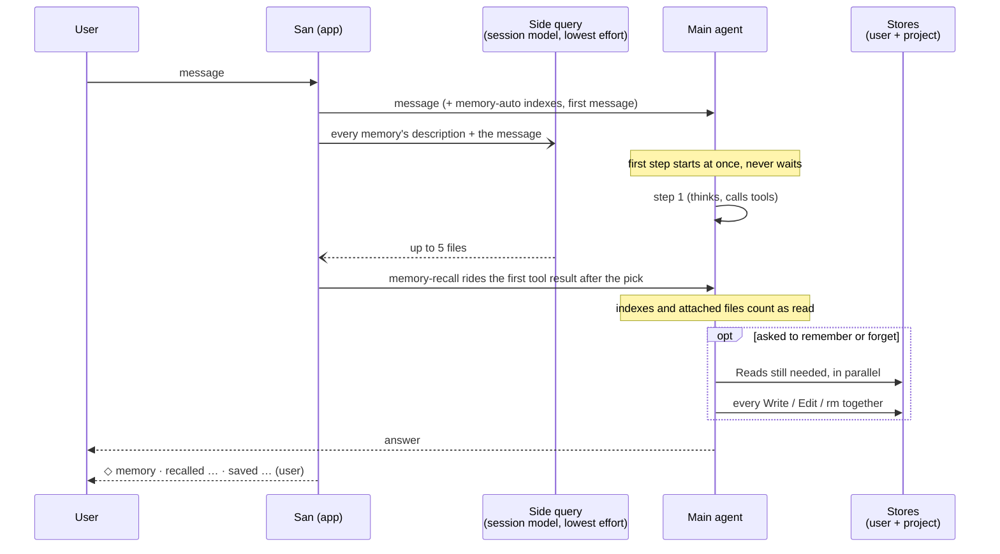

# Harness Channels

San delivers context to the model through **three distinct channels**,
each with different cache, lifecycle, and stability properties:

| Channel | What lives there | Cache-friendly? | Mutable mid-session? |
|---|---|---|---|
| **System prompt** | Identity, output style, engineering defaults, policy, guidelines, environment footer. Slot-sectioned. | Yes — invariant per session unless a section mutates. | Yes (Use/Drop), but expensive (cache miss). |
| **`<system-reminder>` blocks** | Session-level / project-level dynamic content: **active-skills directory**, AGENTS.md memory, one-time notices. Attached below the next user message. | Yes — once attached, the user message is immutable. | No (re-emitted as new attachments, never mutated). |
| **User messages** | The actual prompt the user typed. | Yes — already cached. | No. |

> The active-skills list (what skills the model is currently aware of) used
> to live in the system prompt. It now rides on user messages as a
> `<system-reminder source="skills-directory">` block — toggling a skill
> no longer busts the prompt cache.

The harness chooses which channel to use based on **how often the content
changes** and **whether the LLM's prompt cache should survive the
change**.

## Why Three Channels?

The LLM's prompt cache works on **exact prefix match**. Anything in the
system prompt that mutates invalidates the cache prefix from that point
onward — so frequent system-prompt edits are expensive.

The harness optimizes:

- **System prompt** = "things true for every turn of this session".
  Identity, policy, communication style, engineering defaults, tool-
  usage guidelines, environment. Mutates rarely. (Tool *schemas* are
  passed separately via the LLM API's `tools` parameter, not in the
  system prompt text.)
- **`<system-reminder>` blocks** = "things true now, but may change". Each
  reminder is attached to a *user message* (not the system prompt) and
  re-emitted on session start and after every PostCompact. Because user
  messages are immutable once attached, the cache from prior turns stays
  valid; only the new user message + reminder is freshly evaluated.
- **User messages** = actual user input.

## System Prompt: Slot Sections

The system prompt is composed of **Sections**, each owning a numbered
**Slot**. Slots define ordering. Sections within the same slot use
insertion order, so several sections can stack inside one slot (a
subagent's injected charter lands in slot 0 alongside the identity).
Mutations to a section trigger `Refresh` (lazy re-render).

```
slot 0   identity        who you are — built-in or custom persona, and
                         a subagent's injected charter
slot 1   behavior        how you communicate and work: tone and updates
                         merged with the engineering defaults
                         (main agent only — a subagent carries its
                         working style in its charter)
slot 2   rules           safety contract plus the tool / task / git
                         protocols; then the auto-memory instructions
                         (main agent, when auto memory is on)
slot 3   environment     date, cwd, git branch, platform — volatile,
                         placed last so daily/cwd changes don't bust
                         the cache prefix above
```

Slot constants live in `internal/core/section.go`; the default applier
and renderers live in `internal/core/system/catalog.go`. Skills, memory,
and the agent directory are intentionally **not** slots — they ride on
the reminder channel (skills, memory) or on tool schemas (agent
directory) instead.

See [`packages/core.md`](../packages/3-core/core.md) for the `Section` and
`System` types.

## Reminders

Reminders carry "session-level" or "project-level" mutable content. The
harness has standard providers:

| Provider ID | Source | Re-emit triggers |
|---|---|---|
| `skills-directory` | active skills (and the "use Skill tool to invoke" preamble) | session start, PostCompact, skill enable/disable/activate |
| `memory-user` | `~/.san/AGENTS.md` and `~/.san/rules/*.md` | session start, PostCompact, file change |
| `memory-project` | every `AGENTS.md` from the repository root down to the cwd, `<cwd>/.san/rules/*.md`, and `<root>/AGENTS.local.md` | session start, PostCompact, file change, cwd change |

Each provider has a stable ID; re-emitting from the same ID **drops the
previous queued entry**, so toggling a skill three times in a row
produces one final reminder, not three.

Reminders wrap their body in:

```xml
<system-reminder source="skills-directory">
  Enabled skills:
  - github:create-pr — ...
  - jira:link-ticket — ...
</system-reminder>
```

The LLM is instructed to treat the `<system-reminder>` tag as a system
instruction even though it appears inside a user message. That directive
is the "System reminders" part of the `<rules>` section (source:
`internal/core/system/prompts/rules.txt`), applied to both main and
subagent scopes — subagents receive reminders too (the skills
directory). It also tells the model to act on the most recent reminder
values (they refresh and re-inject after compaction) and not to echo the
tags back to the user.

Implementation: [`packages/reminder.md`](../packages/2-feature/reminder.md).

## Memory: AGENTS.md

San follows the [AGENTS.md](https://agents.md) standard. Two memory tiers:

- **User memory**: `~/.san/AGENTS.md`, plus `~/.san/rules/*.md`. Loaded
  once per session, attached as the `memory-user` reminder.
- **Project memory**: every `AGENTS.md` from the repository root down to
  the working directory, then `<cwd>/.san/rules/*.md`, then the
  git-ignored `<root>/AGENTS.local.md`. Files nearer the working
  directory are injected last, so the closest instructions win — the
  precedence Codex and Cursor use. The combined body is capped at 32 KB.
  Attached as the `memory-project` reminder.

Memory is **never** in the system prompt — that would invalidate the
prompt cache every time the user edited their memory file.

Each memory reminder leads with a one-line **preamble** framing the
content for the model (e.g. *"The following is the user's saved memory
(preferences and standing instructions). Apply it throughout this
session."*) before the `<memory scope="…">` envelope. The raw memory text
alone carries no instruction to follow it; the preamble supplies that
framing, mirroring how the skills directory self-introduces.
`reminder.WrapMemory` owns this shape.

## Auto memory

Besides the user-authored AGENTS.md, the main agent keeps its own memory in
two stores: the user store `~/.san/memory/` for what holds in every repository,
and a project store per repository at `~/.san/projects/<repo-root>/memory/`
(subdirectories and linked worktrees share it). The prompt tells the model which
store each memory belongs in; the project store wins on conflict. One
message's path through memory:



Each store follows Claude Code's layout:

- `MEMORY.md` is an index, one line per memory. Each store's first 200 lines /
  25 KB ride the `memory-auto` reminder, framed as context rather than user
  instructions. Index problems (near or over the cap, unindexed topic files,
  links to missing files) are appended so the agent repairs them; writes are
  not checked one by one, since a step's writes land together.
- Each memory is its own file with `name` / `description` / `type`
  frontmatter, dated by its file's mtime (a recall shows the date). San never
  rewrites a file the agent wrote. The category lives in `type`, not the file name: two feedback
  memories are two files, each named for its content (`concise-comments.md`).

  | `type` | Holds | Notes |
  |---|---|---|
  | `user` | who the user is: role, expertise, preferences | changes slowly |
  | `feedback` | corrections and confirmed approaches | body adds **Why:** / **How to apply:** |
  | `project` | ongoing work, decisions, deadlines not in code or git | absolute dates; goes stale fastest |
  | `reference` | where outside information lives | trackers, dashboards, docs |

  Only the model reads `type`; the harness treats all four alike.
- Recall, as in Claude Code's prefetch: when a message goes to the agent, a
  side query to the session model (its lightest reasoning rung) picks up to
  five memories whose `description` bears on it. The turn never waits: the
  pick's contents ride the `memory-recall` reminder on the first tool result
  that completes after it lands, and a turn that calls no tool goes without
  (the indexes are still there to Read from). A memory is attached once per
  conversation; the reminder is hidden from the tool result on screen.
- The indexes and attached memories count as read, so the agent edits them
  without a Read first. The `memory` rules section tells it what to save and in
  which store, and to do memory work in at most two responses: the Reads it
  still needs, then every Write, Edit and `rm` together. Writes to `*.md`
  inside either store need no approval in any mode, headless (`san -p`) and
  don't-ask included; deny rules still apply. Both store directories are
  created up front, and an empty store shows in the reminder as
  `(no memories yet)`, so the agent neither runs `mkdir` nor reads a missing
  index. Forgetting is a plain `rm` of memory files (at most `-f`, literal
  paths, nothing chained), also unprompted; anything wider asks.
- Memory stays out of the chat flow. A step that only touched memory draws
  nothing once settled; while it runs, its row is the spinner saying
  `Thinking...`, as the next step will (a label of its own would only flash). Each turn that touched memory
  ends with one quiet line under the answer, by index title, grouped by verb:
  `◇ memory · recalled Release freeze · saved No AI attribution (user)`; one
  entry per memory (a write outranks a read, and names its store), and
  `forgot` for one the turn touched that is gone by its end. ctrl+o shows the
  calls themselves; a failed call always does. A memory file in both stores
  is reported in the next index reminder as a duplicate to fix.

On by default. `/memory` toggles it for all projects (`t`, or `/memory on|off`)
or for this project (`p`, or `/memory on|off project`), writing `autoMemory` to
the user or project settings; the project value wins, and
`SAN_DISABLE_AUTO_MEMORY=1` beats both. A toggle applies from the next turn; moving a store or turning memory off
mid-session re-sends the index reminder (or an "auto memory is now off" notice),
since the one sent at session start names the old state.
`autoMemoryDirectory` (absolute or `~/` path) moves the store of the file that
sets it: `~/.san/settings.json` the user store, an untracked
`.san/settings.local.json` the project store. Committed project settings never
count, since memory writes need no approval. Claude Code instead uses one store,
so a user-level value there merges every project's memory. `/memory` lists each
store on its own row with its directory; `d` there changes the selected
store's directory, writing the setting to the right file (empty restores the
default) and moving its memories along unless the new directory already holds
some. Subagents don't load either store.
Skills are separate: `/evolve` reviews turns and edits skills, never memory.
Unlike Claude Code, there is no background extraction pass: the agent saves
during the turn, when asked or when it learns something worth keeping.

**Subagents receive the skills directory and, when they can edit the workspace,
project instruction memory.** Read-only workers omit project memory; user memory
stays with the main loop. Subagents are one-shot workers with fresh conversations,
so the parent must still supply the task's relevant context. See
`internal/subagent/executor.go` (`collectSubagentReminders`).

## Compaction

Compaction is **not** a channel by itself — it's a mutation of the
user-message channel that leaves the other two alone:

- the **system prompt** is reused from cache (never rebuilt),
- the **messages** collapse into a single `Previous context:` summary message,
- the **`<system-reminder>` blocks** are stripped from the summarization input
  (`core.BuildCompactionText` peels the trailing reminder run off each user
  message) and re-emitted fresh on the next user turn, so every reminder
  provider shares one lifecycle: injected on the first user message, skipped
  from the summary during compaction, re-injected after `PostCompact`.

`BuildCompactionText`'s sibling `BuildConversationText` keeps reminders intact
and is used for proactive-compaction *size estimation*, where the real prompt —
reminders included — is what the estimate must track.

For the full mechanism — the common pipeline, auto-compact vs. manual
`/compact`, transcript boundary recording, and reminder freshness — see
[`concepts/compaction.md`](compaction.md).

## See Also

- [`concepts/extension-model.md`](extension-model.md) — skills (one
  reminder source) and how plugins contribute to it.
- [`packages/core.md`](../packages/3-core/core.md) — `System`, `Section`, slot
  layout.
- [`packages/reminder.md`](../packages/2-feature/reminder.md) — runtime API.
- [`concepts/compaction.md`](compaction.md) — the full compaction mechanism
  (channels, auto vs. manual, transcript boundary).
- [`packages/session.md`](../packages/2-feature/session.md) — how compaction
  records flow into the transcript.
