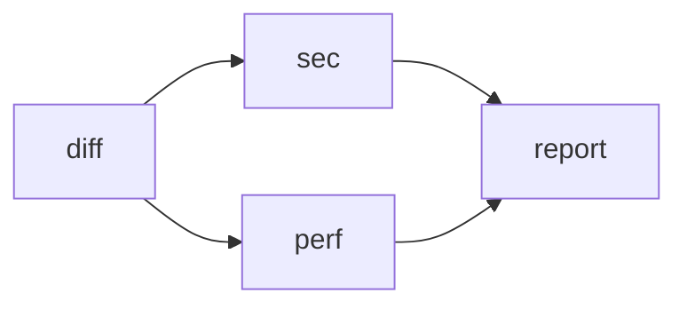
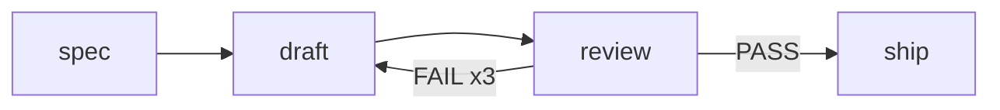

# Workflow

A workflow is several subagent turns arranged as a graph: which runs after
which, which run together, which run only on a given answer. It is one
markdown document, and there are two ways in — a file you saved under
`.san/workflows/`, or a document the model writes on the spot. Either way
San validates the whole thing before anything runs, runs it as one
background task, and delivers one summary when it finishes.

The `Workflow` tool ships **disabled**: enable it from `/tools` to let the
model start workflows on its own. Your saved workflows run with `/workflow`
either way.

Use a workflow when the arrangement matters more than any single job — a
dependency order a long turn could forget, or a fan-out whose intermediate
results should stay out of the main conversation. For one bounded job, or a
one-off fan-out, the `Agent` tool is still the right call.

## The definition

````markdown
---
name: review
max_parallel: 4
---



## diff
mode: explore

Summarize {{input.base}}..HEAD by package

## sec
mode: explore

Security only: {{diff}}

## perf
mode: explore

Performance regressions only: {{diff}}

## report
Merge into one review: {{sec}} {{perf}}
````

| Part | Rule |
| --- | --- |
| frontmatter | optional: `name`, `description`, `max_parallel` (default 4) |
| mermaid block | the only source of topology. Starts with `flowchart LR`; then bare ids joined by `-->` (sequence), `&` (fan-out and fan-in), `-->\|LABEL\|` (conditional) and `-->\|LABEL xN\|` pointing back at an ancestor (a bounded retry; see below). Node shapes, subgraphs and other mermaid syntax are errors, not silently ignored — a dropped edge is a silently wrong graph. |
| `## id` | one node, one subagent turn. Every id in the graph needs a section and vice versa. |
| `key: value` under the heading | the contiguous run of such lines is config: `agent`, `mode` (`explore`, `edit`, `default`), `model`, `continue_on_error`. Everything after them is the prompt. An unknown key is an error; put a blank line before prompt text that happens to start with `word:`. |
| `agent:` | the name of a definition in `.san/agents/`, which is where a node gets its tool list, skills, system prompt and MCP servers. A name that resolves to nothing is refused before the run starts — in a file, an unknown name is a typo, not a label. Leave the line out for the default agent. |
| `{{id}}` | the complete final answer text of an upstream node, inserted into this node's prompt. Any ancestor on a taken path counts, not only the direct parent. Referencing a node with no path here is a validation error. |
| `{{input.key}}` | an author-defined run parameter, collected before launch or supplied as `key=value`. |
| `for_each` + `max_workers` | fans this node out over a plan; see below. |

Every node is a fresh subagent with no memory of the others; brief each one
fully, the way an `Agent` prompt is briefed.

### Inputs and step answers

`{{input.task}}` means “insert the run parameter named `task` here.” `task` is
not a built-in task object or a reserved input name: the definition's prompts
choose the keys. For example, replacing it with `{{input.topic}}` makes `topic`
the required run field, supplied through the form or as `topic="review storage"`.

`{{work}}` means “insert the complete final answer from the step whose ID is
`work`.” It comes from `## work` in the definition, not from an agent name or a
user input. A graph edge determines when a step may run; a template reference
in its prompt determines which answer text it actually receives. In the starter
`work --> review`, `work` reads `{{input.task}}`, and `review` reads both that
same input and `{{work}}`. The `review` answer is the final workflow result.

Ordinary step answers are text, not objects with automatic `{{work.field}}`
access. The separate `for_each: plan.tasks` setting can select an array field
from a step's JSON answer; its workers use `{{item}}` or `{{item.key}}` as
explained below.

## Saved workflows

Definitions live in `.san/workflows/*.md` (project) and
`~/.san/workflows/*.md` (user); the project copy wins when both define the
same name, and the `name:` in frontmatter beats the filename. The `Workflow`
tool lists what it finds in its own description, so the model can run one by
`name` instead of rewriting it. Saved names and input keys are completed
using the same quoted-argument rules as execution. `/workflow show <name>`
previews the graph, step prompts and input keys without starting a task;
`/workflow run <name>` reports missing inputs before launch.

`/workflow` opens the definitions and recent-runs view. Management is explicit
and does not inject authoring instructions into ordinary model turns:

| Command | Action |
| --- | --- |
| `/workflow new [name]` | Open an unsaved, read-only starter in Review. |
| `/workflow from-skill <skill> [name]` | Create a one-node draft referencing an enabled Skill; review before saving. The Skill remains unchanged and its live instructions/resources are loaded when the node runs. No automatic splitting is attempted. |
| `/workflow edit <name>` | Review or edit a saved definition. |
| `/workflow show <name>` | Preview a saved definition without starting it. |
| `/workflow inspect <run-id>` | Inspect a running or previous execution. |
| `/workflow stop [task-id]` | Stop one workflow, or select it by task ID when several run. |
| `/workflow list` | Print the saved definitions. |
| `/workflow <name> key=value …` | Launch directly, with no model turn. Use `/workflow run <name> …` if its name conflicts with a management action. |

In Review, the page lists the values you supply before running. `↑`/`↓` selects
a step and shows where its inserted inputs come from, what answer it produces,
which steps read it, and its instructions. `e` opens the source editor with a
template reminder; `Ctrl+S` validates and previews changes, then `y` saves.
From Review, `s` opens the same save preview. Saving never launches a run.

`d` opens execution limits rather than mixing them into the main review. These
count step executions (including bounded workers and rounds), not individual
model calls, tokens or cost. `max_parallel` is only a ceiling; dependencies
still determine which steps can run together. The sequential starter uses 1.

Existing user definitions become project copies; their source is not
overwritten. A changed on-disk source must be reopened rather than silently
replaced. `r` on a saved review collects required `{{input.key}}` values before
launch. Direct command arguments support quoted spaces:
`/workflow review base="main branch"`. Saved names with spaces are quoted too,
for example `/workflow run "release review" base=main`.

The existing task area (Alt+T) still groups recent node/worker activity above a
compact status graph, reflows at terminal width and retains the full event
trail in the task log. `/workflow stop` bypasses a foreground response's input
queue; its notice waits for that response's conversation tail. With an empty
input, Ctrl+C interrupts a foreground response first, otherwise stops the sole
running workflow or lists IDs when several run. With no running workflow,
the existing double Ctrl+C exit remains unchanged.

A file is parsed when reviewed or run, not at startup: a broken definition
never blocks the session.

### Try a full repository audit

[`examples/workflows/ponytail-audit.md`](../../examples/workflows/ponytail-audit.md)
preserves the original `ponytail-audit` instructions in a read-only workflow.
It keeps all six check categories, the evidence rules, the report format and
its example. The instructions are split into five subagent turns:

- `inspect`: the original audit priorities and **1. Map first**. Establish
  the scope, assumed load, entry points and main data flows; hand off source
  evidence, tests and unread areas.
- `correctness`: original checks **1. Bug** and **4. Missing test**.
- `security`: original checks **2. Risk** and **3. Scale**, including data
  loss and failures at the expected load.
- `maintenance`: original checks **5. Speed** and **6. Lean**, including all
  six lean checks: delete, reuse, stdlib / native, yagni, merge and split.
- `report`: the complete **3. Check before you report** and **4. Output**.
  Collect candidates, re-read evidence, confirm concrete triggers,
  search all references before declaring code unused, deduplicate and rank.
  Write the full report in the original simple-English format, including the
  three groups, continuous numbering, four parts per finding, verdict, lean
  totals and unexamined areas.

The three checks run in parallel after `inspect`; `report` waits for all three.
Verification and report writing share one node, avoiding another agent call
and handoff. Every node runs in `explore` mode and changes no code.

Five nodes do not mean five full repository scans. The first node surveys the
repository and passes focused source evidence to the three checks. They reuse
that evidence and read more where needed. The checks are separate reviews of
the requested scope, not three reviews launched for every file read. The
`report` node verifies candidates, including whole-tree reference searches
for unused code, then writes the report. These are prompt instructions, not
enforced read limits.
Nodes have separate conversations and receive upstream output text, not its
full tool history. Each parallel check receives the same repository context,
and overlapping reads remain possible; both can add token cost. The original
skill keeps its work in one agent context and can also re-read files to verify
a finding; it does not promise exactly one scan.

This example demonstrates parallel review, evidence handoff and verification.
It is not the cheapest way to audit a repository, and parallel execution does
not guarantee a speedup. For a quick first run, scope it to a small package.
A review of changed files, split into non-overlapping file groups, is a more
bounded demonstration of distributing work; this audit deliberately keeps
the original whole-repository checks.

To install the self-contained example:

```bash
mkdir -p .san/workflows
cp examples/workflows/ponytail-audit.md .san/workflows/ponytail-audit.md
```

In the TUI, use `/workflow show ponytail-audit` to inspect the structure,
then `/workflow run ponytail-audit scope=.` for the whole repository, or
`scope=internal/workflow` for one package. The task view names each stage by
its job, so the initial inspection, concurrent checks and final report are
visible. The task log keeps their full tool activity. The example embeds its
prompts; installing a separate Ponytail skill is not required.

## Fanning out over a plan

A node with `for_each` runs once per item of a plan an upstream node
produced, which is how one workflow splits work it could not know in advance:

````markdown
## plan
Split the review into non-overlapping tasks, at most 8, as JSON:
{"tasks":[{"name":"llm","prompt":"Review error handling in internal/llm"}]}

## review
for_each: plan.tasks
max_workers: 8
agent: Explore
mode: explore

{{item.prompt}}

## merge
Merge: {{review}}
````

- `for_each: plan.tasks` reads the first JSON value in `plan`'s output and
  takes its `tasks` field; `for_each: plan` uses the whole value. It must be
  a non-empty array.
- Items may be strings (`{{item}}`) or objects (`{{item.key}}`, and
  `{{item}}` for the whole object). An item's `name` field labels its
  worker; without one the label is its position.
- **`max_workers` is required.** A plan with more items than that is refused
  rather than truncated — so say the same limit in the planning node's
  prompt. This is what makes the worst case knowable before launch, which is
  the only reason dynamic fan-out is allowed at all.
- The two bounds do different jobs: `max_workers` caps how many workers a
  plan may *ask for* (a larger plan is refused), while `max_parallel` caps
  how many turns are *in flight* across the whole run. Workers queue for the
  run's slots like any other node.
- Downstream sees the workers' outputs merged under `## <label>` headings.
  A worker that failed is left out rather than left as an empty heading.
- The orchestrator returns a plan; it does not call the workers. They are
  ordinary nodes, each through the same permission gate with its own
  transcript, so nothing recurses.

The approval dialog states the bound it buys: `up to 14 subagent turns` and
`review: up to 8 workers over plan.tasks`.

## Drafting until a review passes

A conditional edge pointing back at an ancestor is a retry, and it must say
how many:

````markdown


## draft
Write it. Previous review: {{review}}

Spec: {{spec}}

## review
PASS or FAIL: {{draft}}

## ship
Ship {{draft}}
````

Parsing unrolls this into a plain chain — `draft#1 → review#1 ─FAIL→ draft#2
→ …`, with a `PASS` escape from every round to `ship` — so the scheduler,
the permission gate and the summary never learn that a loop existed. What
follows falls out of that:

| Case | Behaviour |
| --- | --- |
| `{{review}}` inside `draft` | the previous round's review; empty on the first |
| `{{draft}}` inside `ship` | the round that actually passed |
| an early round passing | the remaining rounds are omitted, never run |
| every round used up, still `FAIL` | the workflow **fails** — the condition was never met, and a result that failed review must not flow on |
| `review` answering neither `FAIL` nor `PASS` | that round **fails**, in any round. The node carrying the back edge is the one place every answer is declared (the retry label plus the escapes), so an answer outside them is a model gone off-script, not a quiet stop. Any other node — a gate outside the loop or inside its body — keeps gate semantics: an unmatched `NO` means "stop here" and succeeds |
| the bound | required, from `x1` to `x10`. A back edge without `xN` is the cycle error it would otherwise be. The cap is checked before anything is unrolled, since unrolling happens while the approval dialog is being built |
| one loop after another | the second is always entered at its first round, however many rounds the first one took |
| the target | must be an ancestor of the source, or there is no loop to bound |
| a node in two loops, or `for_each` inside one | rejected: rounds × rounds and dynamic × iteration are both cartesian explosions |
| an edge into the body from outside | rejected — route it through the loop's head, or a later round would re-read a node that ran once |

The point of splitting `draft` from `review` is that the review runs in a
clean context instead of grading what it just wrote. The approval dialog
counts every round in its worst case, and names the loop: `draft/review: up
to 3 rounds`.

## How it runs

While a workflow runs, the task area above the input shows a rolling activity
trail grouped by node, then one small status graph. The preview has no status
symbols; the live graph marks waiting (`○`), running (`●/◉` pulse), succeeded
(`✓`), failed (`✗`), skipped (`↷`), and omitted (`⊘`) nodes. A `for_each`
worker gets its own activity block. Model, mode, tool calls, and streamed
model text appear as they arrive. Activity calls rotate a teal `| / - \`
while running, then hold a green `✓` or red `✗` when finished. Their bounded
result preview appears indented below the same call, matched by tool ID even
when several calls finish out of order.
Animation changes only the call's status marker; command and result text stay
unchanged. If a model request fails and retries, its partial text disappears
from Activity. Accepted text and other nodes' output stay visible.
Repeated token-usage lines stay in the task log so the newest eight visible
events focus on work and outcomes. The full trail remains in the task log. The
launch notice gives the task ID and stop command. `Alt+T` hides or shows the
task area. Conditional and retry graphs use a dependency list when a compact
branch view would hide their topology.

- A node starts once every upstream has settled. At most `max_parallel`
  nodes run at once.
- `a -->|HIGH| b` runs `b` only when `a`'s trimmed output equals `HIGH`. A
  node whose upstream edges were all untaken (or whose upstreams were all
  omitted themselves) is **omitted**; it never runs, and a `{{id}}` pointing
  at it renders empty. One taken edge is enough to run.
- A node sees the outputs of the ancestors reached through taken edges. An
  untaken conditional edge hides that branch: in `a -->|X| d`, `{{a}}`
  inside `d` is `a`'s output only when `a` said `X`.
- A failed node **skips** everything downstream and fails the workflow.
  `continue_on_error: true` on the failing node lets downstream run and
  keeps the workflow's verdict clean. What `{{id}}` then renders to depends
  on whether anything whole survived: nothing for an ordinary node, since
  its content is the half-answer it stopped on and a downstream node would
  read that as the finished thing; for a `for_each` node, the workers that
  did finish — their output is complete, there is simply less of it than the
  plan asked for.
- A node fails when its turn ends any way other than the model stopping on
  its own — step cap, truncation, refusal, cancellation, error. A model that
  stops early having done half the job reports success; a converging node
  that reviews its inputs is the guard for that.
- Every node passes the same permission gate as a background `Agent`.
  Ordinary prompts can reach the live session UI; without it they fail closed.
  A definition cannot request `bypass` — internal node `mode` accepts
  `explore`, `edit` and `default` only. A UI answer grants that invocation once,
  never overrides hard denials or changes the node's policy. What `default`
  resolves to remains the subagent layer's business, the same as for `Agent`.
  Approval and question headers name the workflow, run task ID, node, and
  `for_each` worker label when present. These identify the source, not a shared
  worker address; parallel nodes keep independent replies and cancellation.
- `AgentStop` on the workflow's task cancels it: nodes that have not started
  fail, running nodes are interrupted, finished outputs are kept.
- The `Workflow` tool is parent-only, like `Agent`: a subagent cannot start
  one.

## What comes back

The tool returns immediately with the task id. When the run settles, the
task's completion notification carries the summary — one status line per
node, then the output of every sink (a node with nothing downstream). On
failure the notification names the failed and skipped nodes; the full
summary stays in the task output. Each node's transcript is saved under the
session like any subagent's.

```
workflow review succeeded in 1m24s
  ✓ diff (12s)
  ✓ sec (41s)
  ✓ perf (38s)
  ✓ report (27s)

## report
…
```

## Run view and recovery

The run view uses a stable dependency graph, or a dependency list on narrow
screens. Filled circles are completed nodes; running nodes keep a filled
circle whose brightness breathes; hollow circles have not run. Normal node
labels omit status words and times. Total elapsed time stays in the header;
selected-node time and the last three activity lines stay below the graph.
Manual selection pins the detail view; `f` follows active work. `Enter`
inspects output, earlier attempts, workers and retained activity without
forcing the scroll position. Errors remain visible outside that viewport.

Runs are stored as private JSON snapshots in `.san/workflow-runs/`, separate
from definitions. Each keeps the original definition and inputs, complete
node results, worker checkpoints and attempt history. Successful checkpoints
are committed before dependants can run; a persistence failure stops execution.
An exited executor is shown as interrupted, not as a still-animated node.

In the run view, `r` previews retry and continuation; `R` previews rerunning
the selected node and its descendants. Confirmation is required. Default
recovery reuses successful results outside the affected paths, recomputes
conditional routing, and retries failed/unfinished work. Successful workers
are reused only within the same ordered plan. Explicit rerun invalidates the
selected node's workers too. The current saved definition is never silently
substituted for the run snapshot.

Recovery is at node boundaries, not inside an unfinished model turn. A retry
can repeat side effects, especially after an interruption between an external
action and checkpoint commit. Review the current workspace before continuing;
checkpoints are not file rollback or exactly-once execution. Skills, agent
configuration and external resources remain live dependencies. Only one
executor may own a run; uncertain lock ownership blocks recovery rather than
risking duplicate execution. Automatic stale-owner recovery requires a reliable
process-liveness probe and is conservative on Windows.

## Not yet

Graphical topology editing, automatic retries, transactional workspace rollback
and in-node continuation are not supported. Unbounded cycles remain rejected.
