# Feature Overview

[简体中文](features.zh.md)

## Memory and learning

### [Auto memory](concepts/auto-memory.md)

The main agent keeps durable notes in user and project Markdown stores. Recall runs in the background; if ready in time, relevant notes enter the context with a tool result without blocking the turn.

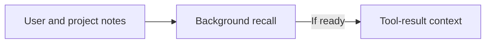

### [Project instructions](concepts/harness-channels.md)

File-based instructions keep repo conventions alongside code. San loads user and project `AGENTS.md` files, rules, and local overrides in scope order, then delivers them as reminders within a shared size limit.

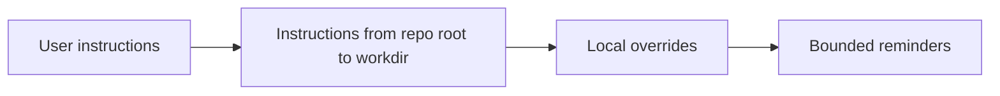

### [Self-learning](packages/selflearn.md)

Off by default, self-learning turns lessons from a completed turn into reusable skills. An eligible `Evolve` request starts a background reviewer that can manage agent-owned skills but cannot edit user-authored ones.

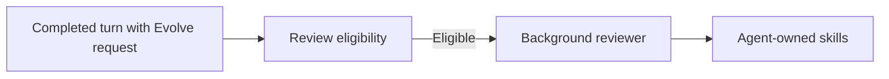

## Agent and session collaboration

### [Subagents](packages/subagent.md)

The `Agent` tool delegates work to a worker with its own conversation and effective permissions. Foreground workers return a tool result; background workers report through the task lifecycle.

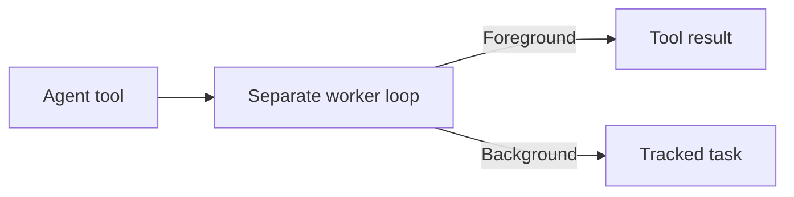

### [Agent messaging](packages/broker.md)

The in-process broker routes messages to the main agent or a worker by task ID. Ordinary messages require a receptive recipient; child completions can be retained in memory for their owning worker.

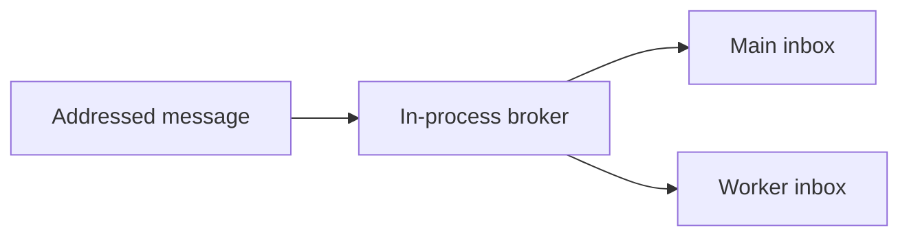

### [Session groups](design/proposal-0003-session-groups.md)

`/group` lets separate San sessions on one machine collaborate. A disk-backed roster and per-member inboxes route messages across processes and retain mail for offline members.

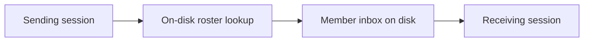

### [Flow: collaboration blueprints](packages/flow.md)

A Flow blueprint describes dependencies between steps. `/flow run` schedules ready steps through San's native task runtime and records checkpoints for retry or resume at step boundaries.

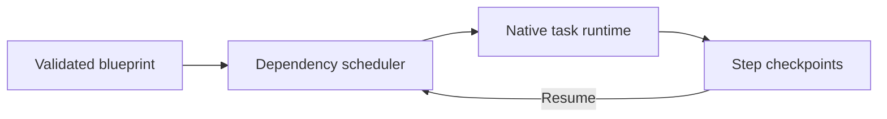

## Sessions, tasks, and automation

### [Sessions](packages/session.md)

Committed event batches are the source of truth for a session. Validated replay rebuilds both the history and the active context; compaction changes the active context without erasing history.

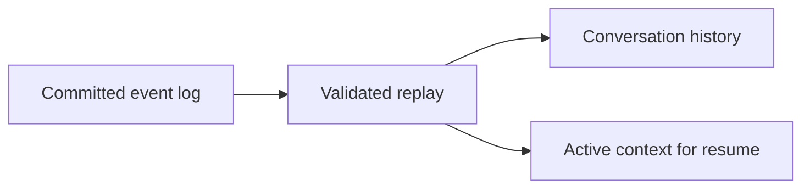

### [Tasks and processes](packages/task.md)

The task manager tracks background work separately from planning todos. It associates shell jobs, workers, and schedulers with their launching session and exposes status, output, and stop controls.

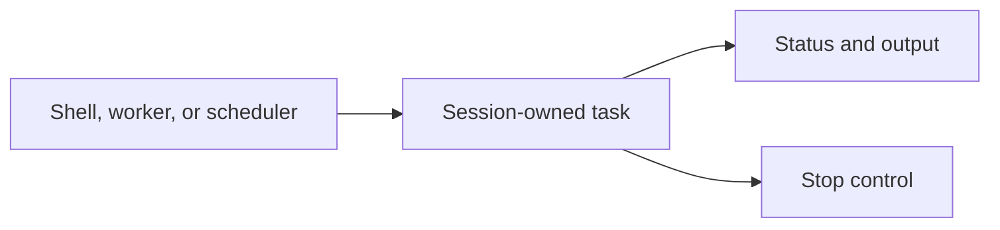

### [Autopilot](guides/autopilot.md)

Autopilot uses a side model to weigh eligible approvals or suggest the next instruction. It starts another turn automatically only while a mission is active and within its limit.

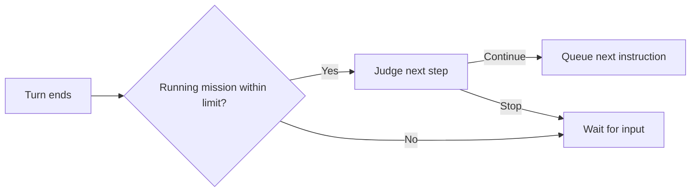

### [Scheduling](packages/cron.md)

An in-process scheduler checks cron jobs while San is running. Due prompts enter the conversation when idle or wait in a queue when busy. Durable definitions survive restarts; no separate daemon runs them.

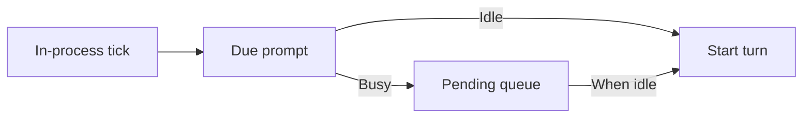

## Tools and extensions

### [Built-in tools](packages/tool.md)

File, shell, and other built-ins register by name and expose schemas to the model. The agent checks permissions before dispatching a call and returns the result to the conversation.

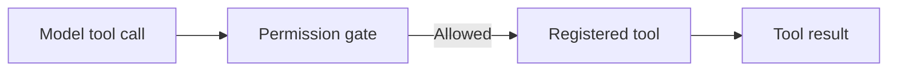

### [Web search](packages/search.md)

`WebSearch` uses a swappable backend selected in `/search`, with Exa as the default. The adapter normalizes titles, URLs, and snippets before the tool formats them for the model.


### [Skills](packages/skill.md)

San discovers reusable instructions from `SKILL.md` files. Active skills advertise their metadata to the model; invoking an available skill loads its full instructions on demand.

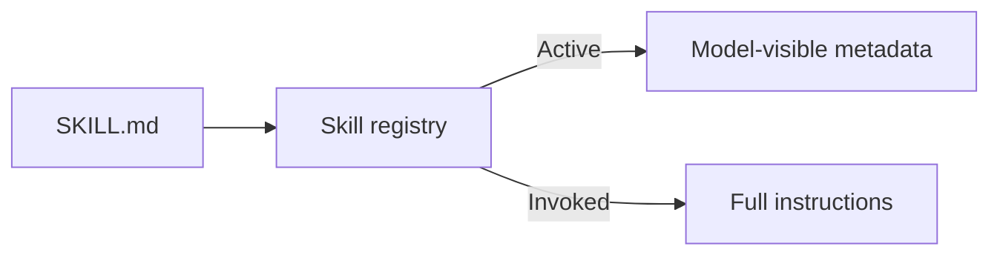

### [Plugins](packages/plugin.md)

Plugins bundle skills, agents, commands, MCP servers, and hooks for installation together. The registry tracks which bundles are enabled; their contributions feed the corresponding extension registries.

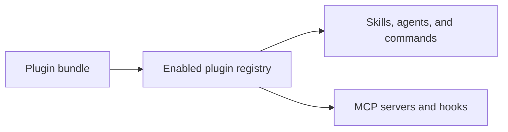

### [MCP](packages/mcp.md)

MCP makes external tools available through the agent's tool interface. San connects to enabled servers over stdio or HTTP, publishes their tool schemas, and routes permitted calls to the owning server.

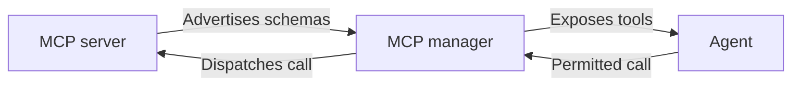

### [Hooks](packages/hook.md)

Hooks extend lifecycle events without changing the agent loop. The engine matches configured handlers to an event; synchronous outcomes can continue or stop the operation, while async hooks run separately.

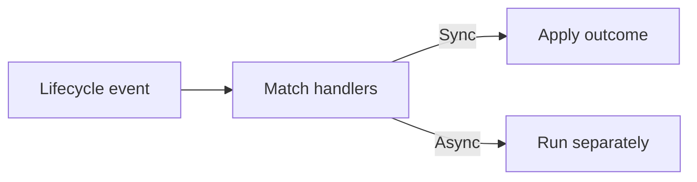

### [Commands](packages/command.md)

One slash palette combines built-in commands, dynamic entries, and custom Markdown prompts. Input is resolved to a handler or a prompt to submit to the agent.

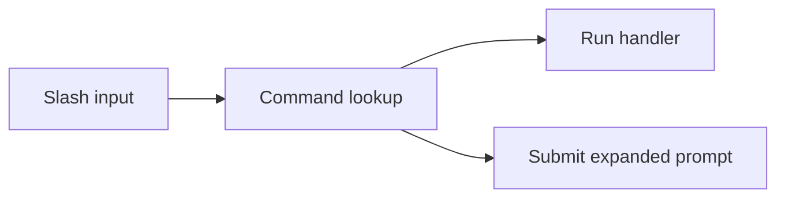

## Models, behavior, and permissions

### [Models and providers](packages/llm.md)

A shared inference interface keeps the agent independent of model vendors. `/models` manages connections and model selection; each inference uses the resolved provider and model.

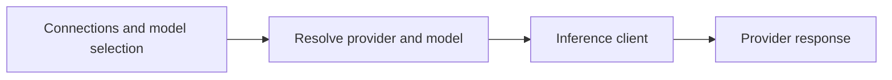

### [Personas](concepts/persona.md)

A persona bundles prompt parts, skills, and a settings overlay. Switching personas updates the prompt and skills for the next inference; tool and permission changes take effect on agent rebuild.

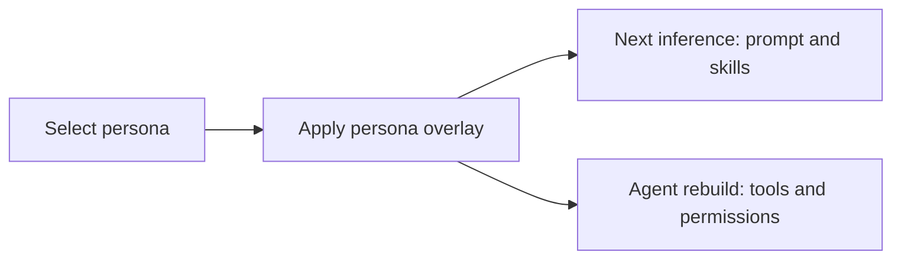

### [Settings](packages/setting.md)

Layered settings keep personal defaults separate from repository overrides. San merges user, project, and local files with field-specific precedence and filters untrusted project settings before they take effect.

```mermaid
flowchart LR
    A[User settings] --> C[Field-specific merge]
    B[Project and local settings] --> T[Workspace trust filter]
    T --> C
    C --> D[Effective settings]
```

### [Permissions](concepts/permission-model.md)

Tool policy resolves ordered rules, safety checks, and mode defaults into allow, deny, or ask. A call that still requires approval is refused when no prompt can be shown.

```mermaid
flowchart LR
    A[Tool request] --> B[Ordered policy checks]
    B --> C[Allow]
    B --> D[Deny]
    B --> E[Ask or refuse if headless]
```

## Interaction and inspection

### [CLI](guides/getting-started.md)

`san` opens an interactive terminal UI. `san -p` or piped input uses the print path, running the agent once and writing the answer to stdout without an interactive UI.

```mermaid
flowchart LR
    A[san] -->|Interactive| B[Terminal UI]
    A -->|Print or pipe| C[One-shot run]
    C --> D[Standard output]
```

### [Inspector](packages/inspector.md)

`san inspector` serves a read-only browser UI on loopback. It uses the native session store to replay committed events and stream new batches over SSE, without writing a second history.

```mermaid
flowchart LR
    A[Native session store] --> B[Read-only local server]
    B -->|Replay and SSE| C[Browser inspector]
```
