# Feature Overview / 功能清单

## Memory and learning

### [Auto memory](concepts/auto-memory.md) / 自动记忆

**EN:** The main agent keeps durable notes in user and project Markdown stores. A background recall ranks relevant notes; if ready in time, they ride a tool result without blocking the turn.

**中文：** 主代理将长期笔记存到用户和项目级 Markdown 文件中。后台检索筛选相关笔记；结果若及时就绪，就随工具结果一并送入上下文，不阻塞当前轮次。

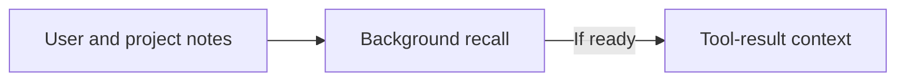

### [Project instructions](concepts/harness-channels.md) / 项目指令

**EN:** File-based instructions keep repo conventions alongside code. San loads user and project `AGENTS.md` files, rules, and local overrides in scope order, then delivers them as reminders within a shared size limit.

**中文：** 文件化指令让仓库约定和代码放在一起。San 按作用域加载用户和项目的 `AGENTS.md`、规则与本地覆盖项，在总大小上限内作为提醒送入上下文。

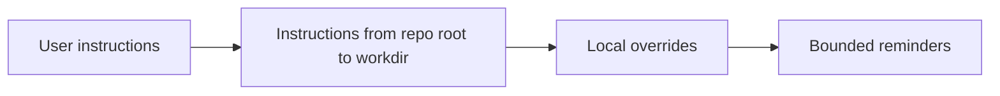

### [Self-learning](packages/selflearn.md) / 自学习

**EN:** Off by default, self-learning turns lessons from a completed turn into reusable skills. An eligible `Evolve` request starts a background reviewer that can manage agent-owned skills but cannot edit user-authored ones.

**中文：** 自学习默认关闭，用于把已完成轮次的经验沉淀成可复用技能。满足条件的 `Evolve` 请求会启动后台审查器；它可管理代理自建的技能，但不能修改用户编写的技能。


## Agent and session collaboration

### [Subagents](packages/subagent.md) / 子代理

**EN:** The `Agent` tool delegates work to a worker with its own conversation and effective permissions. Foreground workers return a tool result; background workers report through the task lifecycle.

**中文：** `Agent` 工具把工作交给拥有独立对话和有效权限的子代理。前台执行直接返回工具结果，后台执行则通过任务状态报告进度和结果。

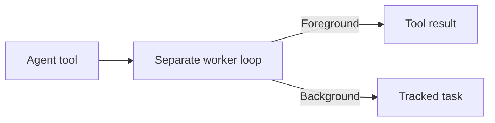

### [Agent messaging](packages/broker.md) / 代理消息

**EN:** The in-process broker routes messages to the main agent or a worker by task ID. Ordinary messages require a receptive recipient; child completions can be retained in memory for their owning worker.

**中文：** 进程内消息代理按地址将消息送给主代理或指定任务 ID 的子代理。普通消息要求接收方当前能接收；子任务的完成结果可在内存中暂存，留给所属子代理。

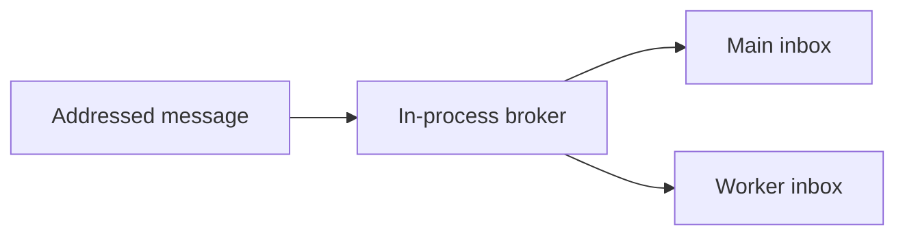

### [Session groups](design/proposal-0003-session-groups.md) / 会话组

**EN:** `/group` lets separate San sessions on one machine collaborate. A disk-backed roster and per-member inboxes route messages across processes and retain mail for offline members.

**中文：** `/group` 让同一台机器上的独立 San 会话协作。成员表和个人收件箱保存在磁盘上，支持跨进程投递，并为离线成员保留消息。


### [Flow: collaboration blueprints](packages/flow.md) / 协作蓝图

**EN:** A Flow blueprint describes dependencies between steps. `/flow run` schedules ready steps through San's native task runtime and records checkpoints for retry or resume at step boundaries.

**中文：** Flow 蓝图定义步骤之间的依赖。`/flow run` 通过 San 原生任务运行时调度已就绪的步骤，并记录检查点，以便按步骤重试或恢复。

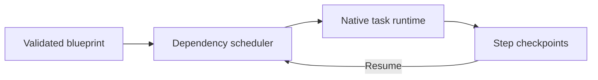

## Sessions, tasks, and automation

### [Sessions](packages/session.md) / 会话

**EN:** Committed event batches are the source of truth for a session. Validated replay rebuilds both the history and the active context; compaction changes the active context without erasing history.

**中文：** 已提交的事件批次是会话的权威记录。经校验的回放重建历史和当前上下文；压缩只改变当前上下文，不删除历史。

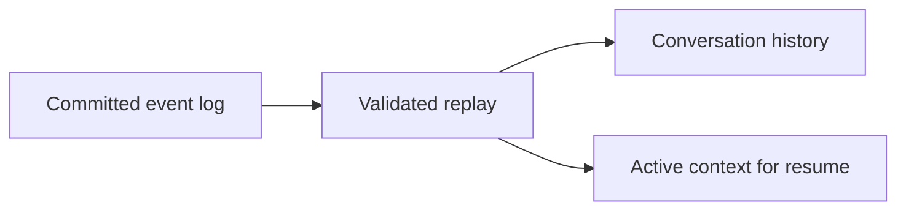

### [Tasks and processes](packages/task.md) / 任务与进程

**EN:** The task manager tracks background work separately from planning todos. It associates shell jobs, workers, and schedulers with their launching session and exposes status, output, and stop controls.

**中文：** 任务管理器追踪实际后台工作，与待办清单分开。它把 Shell 作业、子代理和调度任务关联到发起会话，并提供状态、输出和停止操作。

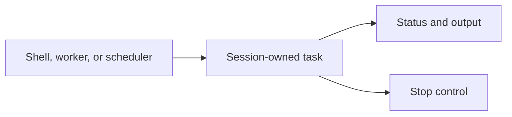

### [Autopilot](guides/autopilot.md) / 自动驾驶

**EN:** Autopilot uses a side model to weigh eligible approvals or suggest the next instruction. It continues a turn automatically only while a mission is engaged, running, and within its limit.

**中文：** 自动驾驶用辅助模型判断符合条件的审批，或建议下一条指令。只有任务目标已启用、正在运行且未达到上限时，才会自动开启下一轮。

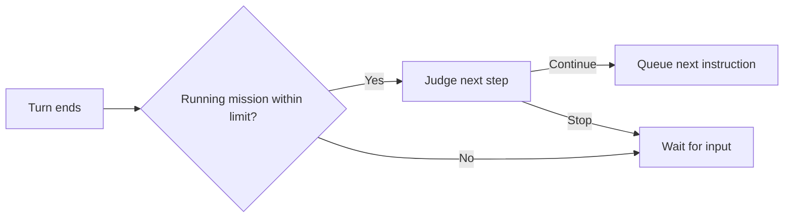

### [Scheduling](packages/cron.md) / 定时调度

**EN:** An in-process scheduler checks cron jobs while San is running. Due prompts enter the conversation when idle or wait in a queue when busy. Durable definitions survive restarts; no separate daemon runs them.

**中文：** San 运行时，进程内调度器检查 cron 作业。到点的提示词在空闲时进入对话，忙碌时先排队。持久化作业定义可跨重启保留，但没有独立守护进程执行它们。

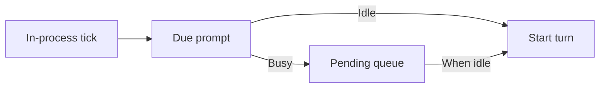

## Tools and extensions

### [Built-in tools](packages/tool.md) / 内置工具

**EN:** File, shell, and other built-ins register by name and expose schemas to the model. The agent checks permissions before dispatching a call and returns the result to the conversation.

**中文：** 文件、Shell 等内置工具按名称注册，并向模型提供参数定义。代理先检查权限，再执行调用并把结果带回对话。

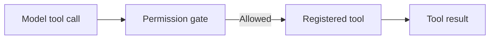

### [Web search](packages/search.md) / 网页搜索

**EN:** `WebSearch` uses a swappable backend selected in `/search`, with Exa as the default. The adapter normalizes titles, URLs, and snippets before the tool formats them for the model.

**中文：** `WebSearch` 通过 `/search` 切换搜索后端，默认使用 Exa。适配器统一标题、链接和摘要的格式，再由工具整理后返回给模型。


### [Skills](packages/skill.md) / 技能

**EN:** San discovers reusable instructions from `SKILL.md` files. Active skills advertise their metadata to the model; invoking an available skill loads its full instructions on demand.

**中文：** San 从 `SKILL.md` 发现可复用的操作指南。活跃技能向模型公开元数据；可用技能被调用时才加载完整说明。

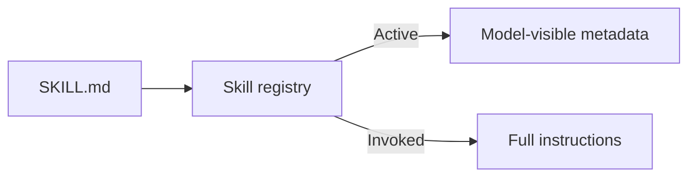

### [Plugins](packages/plugin.md) / 插件

**EN:** Plugins bundle skills, agents, commands, MCP servers, and hooks for installation together. The registry tracks which bundles are enabled; their contributions feed the corresponding extension registries.

**中文：** 插件把技能、代理、命令、MCP 服务和钩子打包安装。注册表记录哪些插件已启用，再把其中的扩展交给对应模块加载。

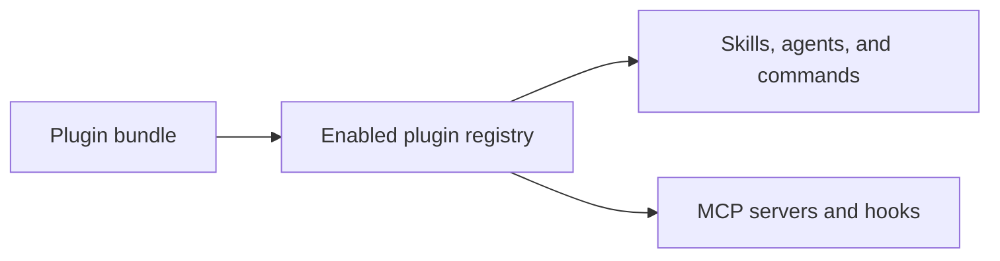

### [MCP](packages/mcp.md) / MCP 外部工具

**EN:** MCP makes external tools available through the agent's tool interface. San connects to enabled servers over stdio or HTTP, publishes their tool schemas, and routes permitted calls to the owning server.

**中文：** MCP 让代理通过统一接口使用外部工具。San 通过 stdio 或 HTTP 连接已启用的服务，公布工具参数定义，再把获准的调用交给对应服务。


### [Hooks](packages/hook.md) / 钩子

**EN:** Hooks extend lifecycle events without changing the agent loop. The engine matches configured handlers to an event; synchronous outcomes can continue or stop the operation, while async hooks run separately.

**中文：** 钩子无需修改代理循环即可扩展生命周期行为。引擎按事件匹配已配置的处理器；同步结果可继续或阻止操作，异步钩子则独立运行。

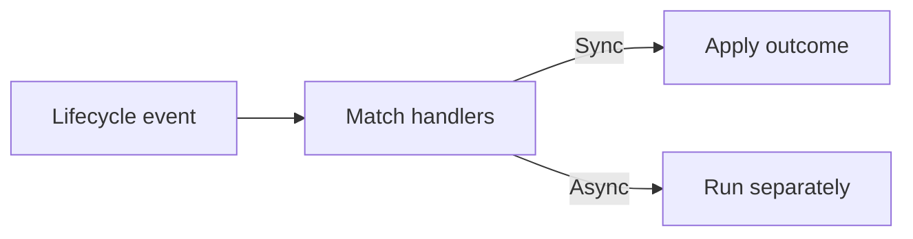

### [Commands](packages/command.md) / 斜杠命令

**EN:** One slash palette combines built-in commands, dynamic entries, and custom Markdown prompts. Input is resolved to a handler or a prompt to submit to the agent.

**中文：** 同一个斜杠菜单汇集内置命令、动态条目和自定义 Markdown 提示词。输入解析后，要么调用处理器，要么将展开后的提示词交给代理。

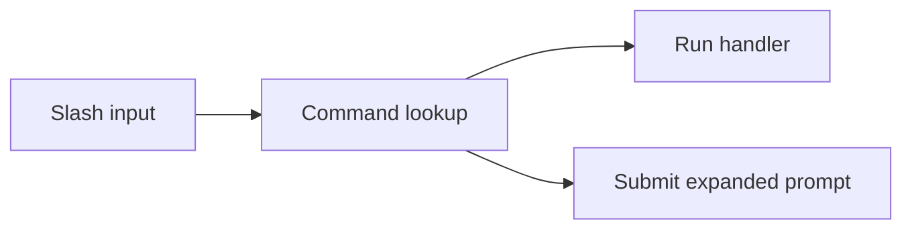

## Models, behavior, and permissions

### [Models and providers](packages/llm.md) / 模型与供应商

**EN:** A shared inference interface keeps the agent independent of model vendors. `/models` manages connections and model selection; each inference uses the resolved provider and model.

**中文：** 统一的推理接口让代理不依赖特定模型供应商。`/models` 管理连接和模型选择，每次推理都交给解析出的供应商和模型。

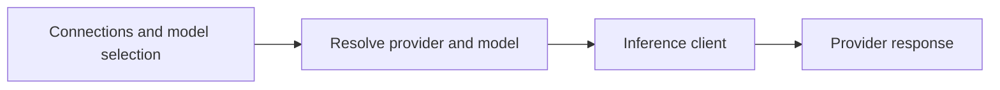

### [Personas](concepts/persona.md) / 角色配置

**EN:** A persona bundles prompt parts, skills, and a settings overlay. Switching personas updates the prompt and skills for the next inference; tool and permission changes take effect on agent rebuild.

**中文：** 角色把提示词片段、技能和配置覆盖打包。切换后，提示词和技能用于下一次推理；工具与权限变更在重建代理时生效。

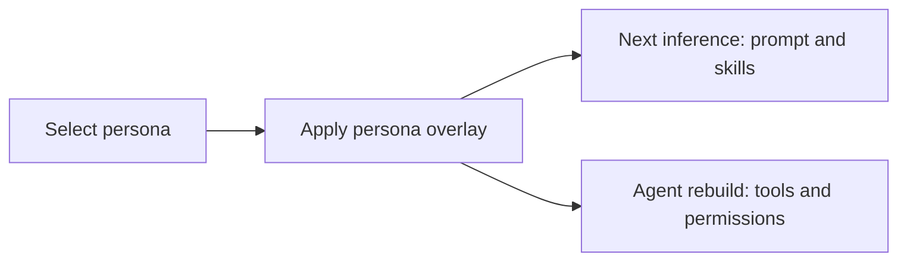

### [Settings](packages/setting.md) / 设置

**EN:** Layered settings keep personal defaults separate from repository overrides. San merges user, project, and local files with field-specific precedence and filters untrusted project settings before they take effect.

**中文：** 分层设置将个人默认值与仓库覆盖项分开。San 按字段规则合并用户、项目和本地配置，不可信的项目设置须先经过过滤。

```mermaid
flowchart LR
    A[User settings] --> C[Field-specific merge]
    B[Project and local settings] --> T[Workspace trust filter]
    T --> C
    C --> D[Effective settings]
```

### [Permissions](concepts/permission-model.md) / 权限

**EN:** Tool policy resolves ordered rules, safety checks, and mode defaults into allow, deny, or ask. A call that still requires approval is refused when no prompt can be shown.

**中文：** 工具权限按优先级检查规则、安全限制和模式默认值，得出允许、拒绝或询问。仍需人工批准的调用，在无法展示询问时会被拒绝。

```mermaid
flowchart LR
    A[Tool request] --> B[Ordered policy checks]
    B --> C[Allow]
    B --> D[Deny]
    B --> E[Ask or refuse if headless]
```

## Interaction and inspection

### [CLI](guides/getting-started.md) / 命令行

**EN:** `san` opens an interactive terminal UI. `san -p` or piped input uses the print path, running the agent once and writing the answer to stdout without an interactive UI.

**中文：** `san` 启动交互式终端界面；`san -p` 或管道输入走打印模式，执行一次代理请求并把答案写到标准输出，不打开交互界面。

```mermaid
flowchart LR
    A[san] -->|Interactive| B[Terminal UI]
    A -->|Print or pipe| C[One-shot run]
    C --> D[Standard output]
```

### [Inspector](packages/inspector.md) / 会话检查器

**EN:** `san inspector` serves a read-only browser UI on loopback. It uses the native session store to replay committed events and stream new batches over SSE, without writing a second history.

**中文：** `san inspector` 在本机回环地址提供只读网页。它从原生会话存储回放已提交事件，并通过 SSE 推送新批次，不另写一份历史。

```mermaid
flowchart LR
    A[Native session store] --> B[Read-only local server]
    B -->|Replay and SSE| C[Browser inspector]
```
