# 功能清单

[English](features.md)

## 记忆与学习

### [自动记忆](concepts/auto-memory.md)

主代理将长期笔记存到用户和项目级 Markdown 文件中。后台检索筛选相关笔记；结果若及时就绪，就随工具结果一并送入上下文，不阻塞当前轮次。

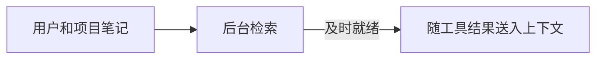

### [项目指令](concepts/harness-channels.md)

用文件把仓库约定和代码放在一起。San 按作用域加载用户和项目的 `AGENTS.md`、规则与本地覆盖项，在总大小上限内作为提醒送入上下文。

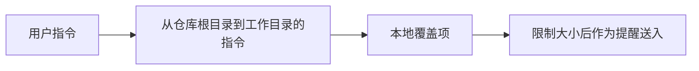

### [自学习](packages/selflearn.md)

自学习默认关闭，用于把已完成轮次的经验沉淀成可复用技能。满足条件的 `Evolve` 请求会启动后台审查器；它可管理代理自建的技能，但不能修改用户编写的技能。

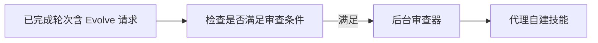

## 代理与会话协作

### [子代理](packages/subagent.md)

`Agent` 工具把工作交给拥有独立对话和有效权限的子代理。前台执行直接返回工具结果，后台执行则通过任务状态报告进度和结果。

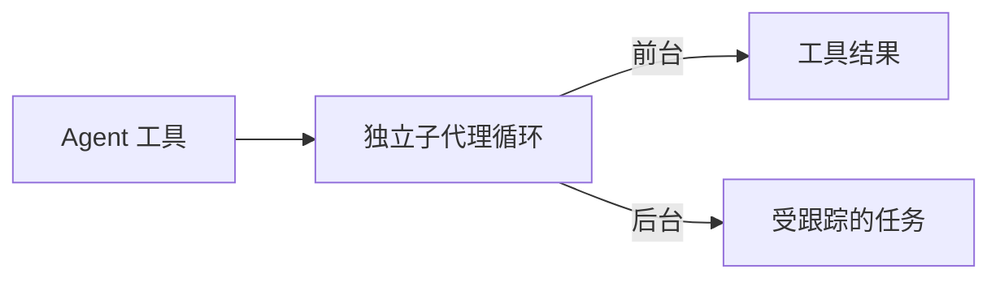

### [代理消息](packages/broker.md)

进程内消息代理按地址将消息送给主代理或指定任务 ID 的子代理。普通消息要求接收方当前能接收；子任务的完成结果可在内存中暂存，留给所属子代理。

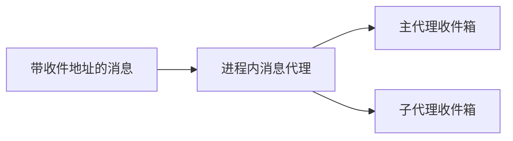

### [会话组](design/proposal-0003-session-groups.zh.md)

`/group` 让同一台机器上的独立 San 会话协作。成员表和个人收件箱保存在磁盘上，支持跨进程投递，并为离线成员保留消息。

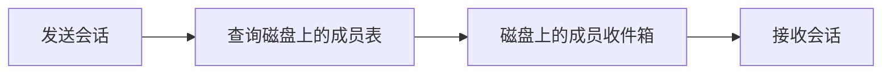

### [Flow：协作蓝图](packages/flow.md)

Flow 蓝图定义步骤之间的依赖。`/flow run` 通过 San 原生任务运行时调度已就绪的步骤，并记录检查点，以便按步骤重试或恢复。

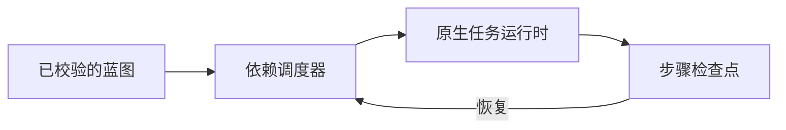

## 会话、任务与自动化

### [会话](packages/session.md)

已提交的事件批次是会话的权威记录。经校验的回放重建历史和当前上下文；压缩只改变当前上下文，不删除历史。

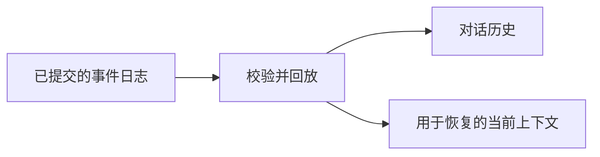

### [任务与进程](packages/task.md)

任务管理器追踪实际后台工作，与待办清单分开。它把 Shell 作业、子代理和调度任务关联到发起会话，并提供状态、输出和停止操作。

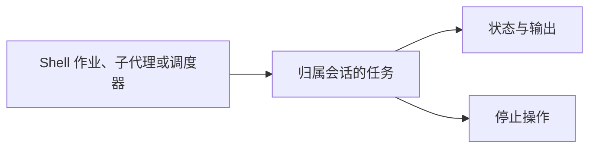

### [自动驾驶](guides/autopilot.zh.md)

自动驾驶用辅助模型判断符合条件的审批，或建议下一条指令。只有任务目标处于运行中且未达到上限时，才会自动开启下一轮。

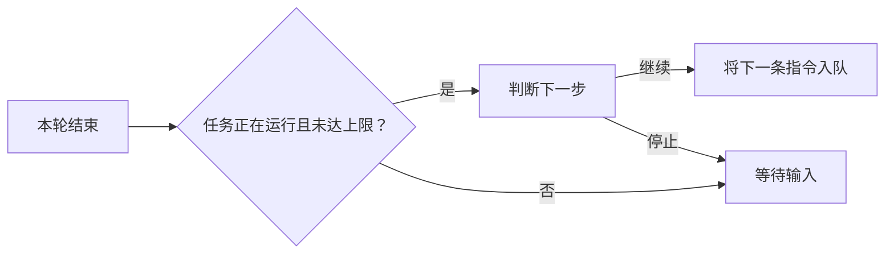

### [定时调度](packages/cron.md)

San 运行时，进程内调度器检查 cron 作业。到点的提示词在空闲时进入对话，忙碌时先排队。持久化作业定义可跨重启保留，但没有独立守护进程执行它们。

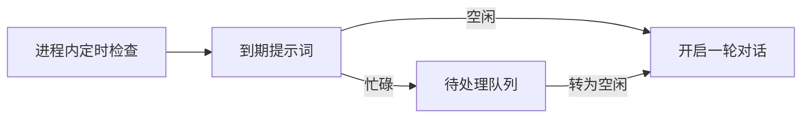

## 工具与扩展

### [内置工具](packages/tool.md)

文件和 Shell 等内置工具按名称注册，并向模型提供参数定义。代理先检查权限，再执行调用并把结果带回对话。

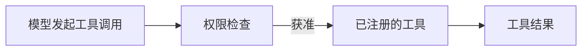

### [网页搜索](packages/search.md)

`WebSearch` 通过 `/search` 切换搜索后端，默认使用 Exa。适配器统一标题、链接和摘要的格式，再由工具整理后返回给模型。


### [技能](packages/skill.md)

San 从 `SKILL.md` 发现可复用的操作指南。活跃技能向模型公开元数据；可用技能被调用时才加载完整说明。

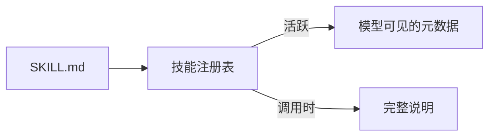

### [插件](packages/plugin.zh.md)

插件把技能、代理、命令、MCP 服务和钩子打包安装。注册表记录哪些插件已启用，再把其中的扩展交给对应模块加载。

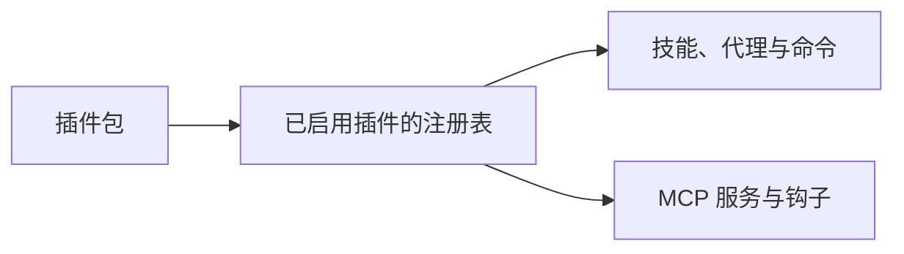

### [MCP 外部工具](packages/mcp.md)

MCP 让代理通过统一接口使用外部工具。San 通过 stdio 或 HTTP 连接已启用的服务，公布工具参数定义，再把获准的调用交给对应服务。

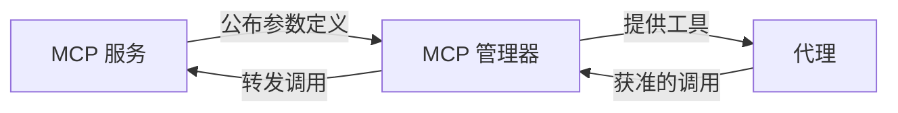

### [钩子](packages/hook.md)

钩子无需修改代理循环即可扩展生命周期行为。引擎按事件匹配已配置的处理器；同步钩子的结果可继续或阻止操作，异步钩子则独立运行。

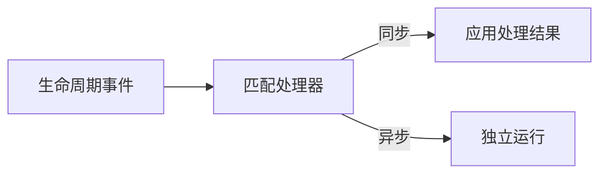

### [斜杠命令](packages/command.md)

同一个斜杠菜单汇集内置命令、动态条目和自定义 Markdown 提示词。解析输入后，San 执行对应处理器，或将展开后的提示词交给代理。

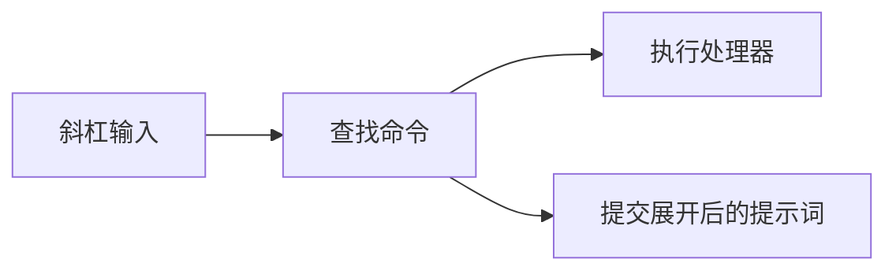

## 模型、行为与权限

### [模型与供应商](packages/llm.md)

统一的推理接口让代理不依赖特定模型供应商。`/models` 管理连接和模型选择，每次推理都交给解析出的供应商和模型。

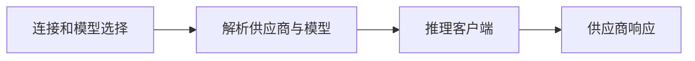

### [角色配置](concepts/persona.md)

角色把提示词片段、技能和设置覆盖项打包。切换后，提示词和技能用于下一次推理；工具与权限变更在重建代理时生效。

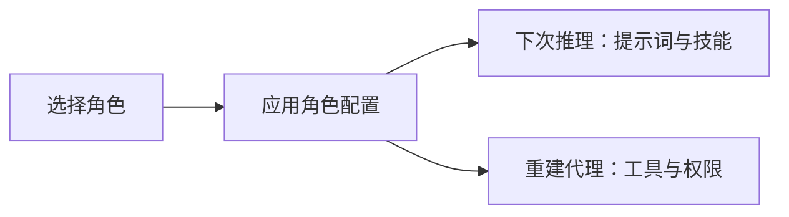

### [设置](packages/setting.md)

分层设置将个人默认值与仓库覆盖项分开。San 按字段规则合并用户、项目和本地配置，不可信的项目设置须先经过过滤。

```mermaid
flowchart LR
    A[用户设置] --> C[按字段合并]
    B[项目和本地设置] --> T[工作区信任过滤]
    T --> C
    C --> D[有效设置]
```

### [权限](concepts/permission-model.md)

工具权限按优先级检查规则、安全限制和模式默认值，得出允许、拒绝或询问。仍需人工批准的调用，在无法展示询问时会被拒绝。

```mermaid
flowchart LR
    A[工具调用请求] --> B[按优先级检查策略]
    B --> C[允许]
    B --> D[拒绝]
    B --> E[询问，无法询问则拒绝]
```

## 交互与检查

### [命令行](guides/getting-started.md)

`san` 启动交互式终端界面；`san -p` 或管道输入走打印模式，执行一次代理请求并把答案写到标准输出，不打开交互界面。

```mermaid
flowchart LR
    A[san] -->|交互模式| B[终端界面]
    A -->|打印模式或管道输入| C[单次运行]
    C --> D[标准输出]
```

### [会话检查器](packages/inspector.md)

`san inspector` 在本机回环地址提供只读网页。它从原生会话存储回放已提交事件，并通过 SSE 推送新批次，不另写一份历史。

```mermaid
flowchart LR
    A[原生会话存储] --> B[本地只读服务]
    B -->|回放与 SSE 推送| C[浏览器检查界面]
```
