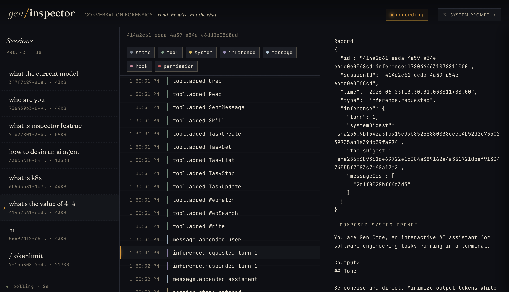

# Inspector

The **Inspector** is a local web UI for exploring san's native session events:
messages, model requests, tool calls, permissions, hooks and harness state. It
reads committed JSONL batches beneath `~/.san/projects/` without acquiring a
session writer or modifying session data.



## Quick Start

```bash
san inspector

# Pin a specific port
san inspector --addr 127.0.0.1:38080

# Print the URL without opening a browser
san inspector --no-open
```

The command starts a loopback-only server on a random port and opens your browser
unless `--no-open` is set. Press `Ctrl-C` to stop.

> **Security:** Session events and request blobs can contain everything a model
> saw, including sensitive tool inputs. Non-loopback bind addresses are rejected.
> The local API has no authentication: treat the port as trusted, avoid shared
> multi-user hosts and stop the server when finished.

## Browse and inspect

The sidebar lists live sessions of the canonical project. Git worktrees share
one project; unrelated clones and non-Git directories do not. Renamed titles take
precedence over generated titles. Unsupported sessions remain listed so their raw
bytes can be diagnosed rather than disappearing silently.

The timeline exposes thirteen event families: session creation/update, native
messages, context compaction, inference start/finish, permission decisions, tool
finishes, instruction/toolset/skill catalogues, hook finishes and annotations.
Filters let you focus on related facts. Events have stable sequence positions
within their session; sequence numbers are not JSONL line numbers, because one
committed line may contain multiple events.

Select an event to inspect its raw typed payload and provenance. Raw committed
SDK batches remain available unchanged. If transport validation fails, the server
reports the checked prefix and explicitly unvalidated bounded diagnostic text;
that text is never treated as projected history.

## Reconstruct the model request

At `inference.start`, the inspector asks the session backend for the request that
was admitted at that exact historical prefix. A conversation request reconstructs
instructions, tool schemas and repaired active native messages; a standalone
request loads its immutable, verified blob. Current settings and later catalogue
changes do not substitute for the historical input.

For other events, cumulative context is reconstructed at the selected sequence.
Compaction changes active context, not full history: earlier turns remain
inspectable. Native images, provider signatures, encrypted reasoning and content
ordering are retained rather than being flattened into a replacement transcript.
Unsupported event versions or invalid provenance fail validated replay instead
of being silently skipped.

## Outcomes and interrupted work

`inference.finish` links its start and carries outcome, usage, duration and any
structured error. Each retry has a distinct start/finish; an unfinished start is
an interrupted call, not a fabricated failure or response.

A `permission.decide` explains the actual authority and, where shown, the human
question snapshot. `tool.finish` records an execution outcome, raw display details
and child-session correlation. Missing finishes do not prove failure: an allowed
call without a committed finish has an unknown outcome. Inspection never reruns
models, hooks or tools.

## Live Tail

Opening a running session subscribes to SSE. Only complete committed batches
appear. Partial suffixes wait for completion; corruption or replacement of the
previously checked prefix ends the stream with a diagnostic rather than splicing
unrelated histories. Browser request generations fence stale selections and
reconnection deduplicates stable identities.

## Storage and API

The server reads:

```text
~/.san/projects/<project>/sessions/<session-id>/events.jsonl
```

There is no older-format reader or fallback to `transcripts/`; sessions written
by earlier versions remain on disk untouched and are not discovered.

| Method | Path | Description |
|---|---|---|
| `GET` | `/` | Embedded inspector SPA |
| `GET` | `/api/sessions` | Live project sessions and diagnostic metadata |
| `GET` | `/api/sessions/{id}/records` | JSON with committed SDK batches, tails and any diagnostics |
| `GET` | `/api/sessions/{id}/stream` | SSE of committed batches |
| `GET` | `/api/sessions/{id}/state/{seq}` | Validated native context or historical inference request |

Listing, state reconstruction and streaming do not modify logs, attrs, locks or
cache files. Server shutdown drains requests; each stream stops with its request.

## See Also

- [Inspector package](../packages/inspector.md) — contracts, tests and internals
- [Sessions](../packages/session.md) — events, request blobs and lifecycle
- [Compaction](../concepts/compaction.md) — active context versus full history
