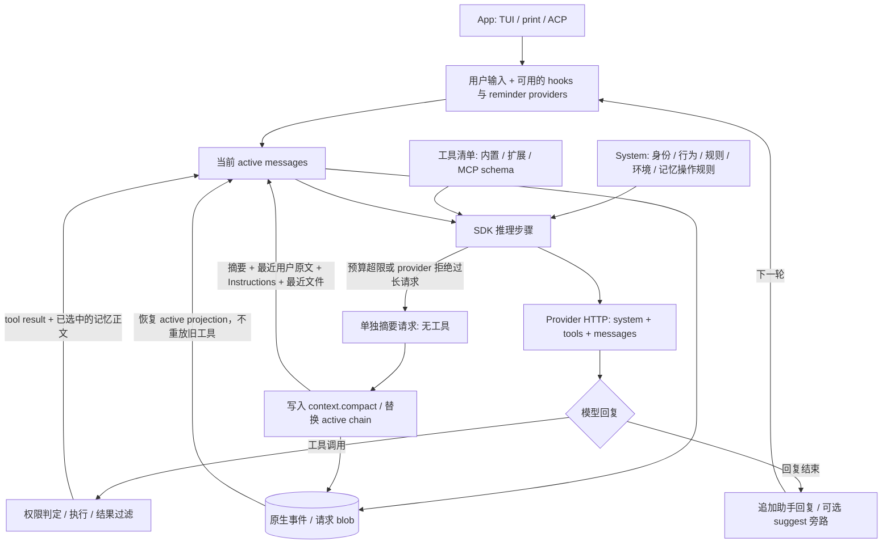

# San Context 注入审计

原始抓包保留作基线；调整后的结果见文末「Reminder 生命周期复测」。

审计版本：San `a3da51ac`，sdk-go `f66df487c9ac`。**主请求的分层基本合理；确认的冗余主要出现在 compact/resume 重新注入、重复工具结果，以及输入建议的旁路请求。** 没有发现主循环在同一个请求里装入两份 system prompt 或工具清单。

## 怎么验证的

从这个 checkout 构建 San，在临时 HOME 和工作目录启动真实 TUI（PTY）及 `san -p`。配置两级 `AGENTS.md`、`AGENTS.local.md`、两份自动记忆索引、一个模型可见的 skill、五类 hooks 和一个小文件，每种内容放不同的标记。让模型接口 fixture 返回两次 `Read`、指定的记忆选择、固定摘要及可控 usage。没有发外网请求、没有打开真实用户记忆。测的是实际 HTTP 请求，不是模型回答质量、真实 token 数、缓存命中率或计费。

四路交叉核对：TUI 的 `/context` 和 compact 状态、模型接口收到的完整 JSON、San 的 `events.jsonl` 及 `inference.start.input.standalone` 指向的请求 blob、源码和已有测试。覆盖无记忆基线、`-p`、TUI 多轮工具调用、主动压缩、压缩后继续输入、先退出再恢复，以及压缩后立即退出再恢复。ACP 和 worker 的差异为源码审查，未对它们做 HTTP 实跑。

## 请求是怎么组成的



| 注入点 | 行为及判断 |
|---|---|
| System | `[identity, behavior, rules, environment]` 加可选的记忆操作规则。`ThinkAct` 初始设置，`PreInfer` 刷新**同一个字段**，不是追加。保持稳定前缀是合理的。见 [builder.go](https://github.com/genai-io/san/blob/a3da51ac42930eee97e9bfc901749edf95e247e8/internal/core/system/builder.go#L43-L78)、[run.go](https://github.com/genai-io/san/blob/a3da51ac42930eee97e9bfc901749edf95e247e8/internal/core/run.go#L374-L383)、[PreInfer](https://github.com/genai-io/san/blob/a3da51ac42930eee97e9bfc901749edf95e247e8/internal/core/run.go#L449-L473)。 |
| 工具 schema | 独立于 system；工具还可能因宿主、配置或会话不同而变动。模型看得到工具不等于允许执行，权限是在调用时另判。schema 跨步骤重发一次属于请求结构，不是同一请求重复；内容仍有瘦身空间。见 [build.go](https://github.com/genai-io/san/blob/a3da51ac42930eee97e9bfc901749edf95e247e8/internal/agent/build.go#L130-L163)、[gate.go](https://github.com/genai-io/san/blob/a3da51ac42930eee97e9bfc901749edf95e247e8/internal/tool/gate.go#L99-L163)。 |
| Instructions 与 reminders | TUI 首次在用户输入尾部附上用户／项目／本地 Instructions、可见 skill 目录、自动记忆索引、可选 group roster 和事件通知。目录只列名称、描述等，正文通过显式使用 skill 加载。`<system-reminder>` 在 Anthropic 抓包仍是消息里的文本，不是 provider `system`。后续请求里同一条历史提醒仍是一个副本，并非每次新注入。见 [agent.go](https://github.com/genai-io/san/blob/a3da51ac42930eee97e9bfc901749edf95e247e8/internal/app/agent.go#L549-L593)、[skills registry](https://github.com/genai-io/san/blob/a3da51ac42930eee97e9bfc901749edf95e247e8/internal/skill/registry.go#L277-L309)。 |
| 自动记忆 | 操作规则、`MEMORY.md` 索引、记忆正文是三种不同信息。另一个无工具请求用用户输入和候选描述选记忆；正文不阻塞首个主请求，测试里到第一条 `Read` 结果才进入主请求。没有后续工具批次时，不能假设正文会覆盖到当前回答。见 [memory_recall.go](https://github.com/genai-io/san/blob/a3da51ac42930eee97e9bfc901749edf95e247e8/internal/agent/memory_recall.go#L49-L105)、[WithRecall](https://github.com/genai-io/san/blob/a3da51ac42930eee97e9bfc901749edf95e247e8/internal/agent/memory_recall.go#L213-L276)。 |
| 工具结果、hook | 模型看到的是过滤后的结果，不等于完整工具日志；文本超过 100,000 B 可落 blob，以约 10,000 B 预览进入活跃链。TUI 的 `SessionStart`、`UserPromptSubmit` 标记进入用户消息；同一场景的成功 `PreToolUse`、`PostToolUse`、`PostCompact` 有 `hook.finish`，但它们的 `additionalContext` 标记不在模型请求里。PreTool 可改变参数或裁决，阻断时还可将 context 用作原因；两个 Post hook 在这些路径异步执行。见 [result_pager.go](https://github.com/genai-io/san/blob/a3da51ac42930eee97e9bfc901749edf95e247e8/internal/agent/result_pager.go#L22-L42)、[gate.go](https://github.com/genai-io/san/blob/a3da51ac42930eee97e9bfc901749edf95e247e8/internal/tool/gate.go#L109-L172)、[post_tool.go](https://github.com/genai-io/san/blob/a3da51ac42930eee97e9bfc901749edf95e247e8/internal/agent/post_tool.go#L40-L63)、[compaction.go](https://github.com/genai-io/san/blob/a3da51ac42930eee97e9bfc901749edf95e247e8/internal/agent/compaction.go#L119-L134)。 |
| 宿主及旁路 | 实测 `-p` 有 Instructions、记忆索引和 recall，也发布了 `Skill` schema，但没有 TUI 的 skill 目录、SessionStart 或 UserPromptSubmit 标记。源码上 ACP、worker 又有各自的注入范围；建议明确差异而非默认三者等价。`suggest`、`recap` 和 `/btw` 使用同一个旁路构造器，本次只抓包验证了 `suggest`。见 [run.go](https://github.com/genai-io/san/blob/a3da51ac42930eee97e9bfc901749edf95e247e8/internal/app/run.go#L204-L278)、[RunOnce](https://github.com/genai-io/san/blob/a3da51ac42930eee97e9bfc901749edf95e247e8/internal/agent/build.go#L327-L375)、[ACP](https://github.com/genai-io/san/blob/a3da51ac42930eee97e9bfc901749edf95e247e8/internal/app/acp.go#L223-L251)、[side.go](https://github.com/genai-io/san/blob/a3da51ac42930eee97e9bfc901749edf95e247e8/internal/app/side.go#L44-L77)。 |

### 工具占用

TUI 首个请求共 **17,940 B JSON**，工具清单 **11,864 B（66%）**，system 字段 **3,862 B**。单个 schema 序列化后（不含数组分隔符，单位 B）：`Agent` 1,878、`Bash` 1,739、`SendMessage` 1,705、`Read` 1,259、`AskUserQuestion` 1,247、`Edit` 1,214、`Skill` 887、`Write` 739、`WebSearch` 692、`WebFetch` 463。只执行了 `Read`，其余数字是广告成本，不代表已运行过这些工具。MCP 和扩展未启用，不能将样本外推成固定大小。

同一个 TUI 实例 `/context` 显示 **17.0k / 20.0k**、**15.9k** 触发压缩，类别约为 system 3.4k、工具 11.2k、skills 208、memory 1.8k、消息 511。**17.0k 是 fixture 提供的上一次主请求 usage，分类是本地估计**；工具百分比与请求 JSON 字节占比口径不同。`/context` 也会计入尚未发出的 pending reminders，不是某次历史 HTTP 请求的精确账单。见 [context_usage.go](https://github.com/genai-io/san/blob/a3da51ac42930eee97e9bfc901749edf95e247e8/internal/app/context_usage.go#L23-L67)。

## 压缩前后的实测时间线

`context window = 20,000`，输出预留 `4,096`，阈值是 `15,904`。第三个主请求返回 `17,000` input，因此第二条真正的用户输入进入后，在发下一次主请求之前触发主动压缩。下表次数指**同一请求里**相同标记出现几次。请求编号含旁路；native `seq` 来自同一个 TUI 会话。

| HTTP / native seq | 阶段 | 活跃请求中观察到的变化 |
|---|---|---|
| `#2` / `9` | 首次推理 | 用户／项目／本地规则各 1、记忆索引各 1、skill 目录 1、hook context 进入输入。 |
| `#3 → #4` / `19 → 26` | 两次 `Read` 同一文件 | recall 正文从 `#3` 起出现 1 次；文件正文从 1 份变 2 份，位于两条有效、独立的 tool result 中。 |
| `#5` / `31` | 输入建议 | 复制当时的主 system、10 个 schema、整个当前消息链，加一个建议提示。没有运行工具。此请求 19,850 B。 |
| `#7` / `38` | 摘要请求 | 独立 system、零工具，把历史扁平化；不带用户消息尾部初始 reminders，但工具文本里已附的 recall 正文和两个文件副本还在。 |
| `#8` / `42` | 压缩后立即推理 | `context.compact` seq `40`（`through: 37`）先落盘；模型只收到**一条** `Previous context:` 消息：摘要、前两条用户原文、各一份 Instructions、重读的一份近期文件。记忆索引、skill 目录和两次 prompt hook 的额外上下文均未恢复。 |
| `#10` / `50` | 不退出，继续第三条输入 | 摘要仍活跃，输入层重发目录、索引，也重发了同样的 Instructions，三种规则各 **2 份**。 |
| `#13` / `59` | 退出后 `san -c` 并输入 | 由同一 summary ID 恢复，不重新执行两次 `Read`。规则各 **3 份**，记忆索引和 skill 目录各 **2 份**。另一个分支在 `#8` 后直接退出再恢复：规则各 **2 份**，索引／skill 目录各 1 份。 |

对 seq `38/42/50/59` 解析对应请求 blob，与其 HTTP 请求比较：system 文本、工具名及顺序、消息条数和文本一致。`context.compact` 的 summary ID 与三个压缩后主请求的首条 native message ID 相同。说明**事件保留完整 transcript、模型只续接活跃投影**这部分工作正常，重复不是 UI 渲染或事件计数造成的。

## 建议优先级

1. **优先修 compact/resume 的 reminder 生命周期。** 目前摘要先内嵌 Instructions，`PostCompact` 又重置准备状态；恢复用完整 UI 行判断是否准备过，且只看“是否有某个 reminder”，不能识别活跃上下文里真正已有哪类、哪一版。以 active projection 为准，按 provider/source + 内容版本跟踪；新版本替换旧快照，补齐立即续跑所需的清单，不重复发送不变内容。区分会话长期上下文和一次性的 hook 输出，明确哪些 hook context 要跨 compact 保存。验收：首次、立即续跑、下一轮、两种恢复路径分别验证每类标记的次数。见 [build.go](https://github.com/genai-io/san/blob/a3da51ac42930eee97e9bfc901749edf95e247e8/internal/agent/build.go#L254-L272)、[model_session.go](https://github.com/genai-io/san/blob/a3da51ac42930eee97e9bfc901749edf95e247e8/internal/app/model_session.go#L379-L384)、[reminder/conversation.go](https://github.com/genai-io/san/blob/a3da51ac42930eee97e9bfc901749edf95e247e8/internal/reminder/conversation.go#L15-L46)。
2. **压缩成功前检查最终请求是否真正 fit。** 当前策略合理处：一般在步骤边界触发、未知预算时仍支持 provider context-exceeded 恢复、普通摘要失败保留原上下文。缺口：至少 3 条消息才压；长历史仍由同一模型另发摘要请求，缺乏整体输入上限，摘要有 4,096 token 上限，但额外拼入用户原文、Instructions、文件后没有最终 fit 检查；它们部分按字节预算。provider 抛错后已换成一条摘要时，通常也无法再压。按真实出站形状为各段留预算，先保护最新用户请求和必要上下文，再按预算缩减文件及旧引用；超限时给出可解释的退路。此条是源码风险，不是样本中的失败。见 [compact.go](https://github.com/genai-io/san/blob/a3da51ac42930eee97e9bfc901749edf95e247e8/internal/core/compact.go#L46-L115)、[recent requests](https://github.com/genai-io/san/blob/a3da51ac42930eee97e9bfc901749edf95e247e8/internal/core/compact.go#L224-L296)、[build.go](https://github.com/genai-io/san/blob/a3da51ac42930eee97e9bfc901749edf95e247e8/internal/agent/build.go#L423-L445)。
3. **给旁路请求单独做预算。** `suggest` 带全工具及历史是为了复用前缀，不等于没成本；本次只确认请求形状，没有测到真实 cache hit。优先比较短摘要＋近期消息、较小的输出上限、去掉 schema 或 provider 支持时显式禁用工具；用 cache hit/miss 的实际延迟、费用和建议质量决定，不要假定删除 schema 一定更省。长上下文也应有旁路降级或跳过策略。验收按 `inference.start.purpose` 分开计账。
4. **把 schema 优化、重复结果处理和 provenance 分开做。** 相同文件路径、读取范围、内容版本一致时，考虑保留 tool call/result 配对、用短引用代替再次送正文；文件变化时仍返最新实质内容。优先审高占用 schema 与主规则是否重叠，再对比注册但不可发现的 `Skill`。另外，通用 `<system-reminder>` 标签是普通用户消息文本里的约定，不是权威边界；应由宿主保留来源元数据，不应仅按文本标签辨认证明。自定义 persona 替换默认规则后也应保留必要的来源语义。见 [reminder.go](https://github.com/genai-io/san/blob/a3da51ac42930eee97e9bfc901749edf95e247e8/internal/reminder/reminder.go#L259-L346)、[rules.txt](https://github.com/genai-io/san/blob/a3da51ac42930eee97e9bfc901749edf95e247e8/internal/core/system/prompts/rules.txt#L5-L7)、[catalog.go](https://github.com/genai-io/san/blob/a3da51ac42930eee97e9bfc901749edf95e247e8/internal/core/system/catalog.go#L136-L153)。

## 回归验证

以下现有测试全部通过（`kit/suggest`、`trigger` 无测试文件）：

```sh
go test ./internal/app/... ./internal/agent ./internal/core/... \
  ./internal/reminder ./internal/session ./internal/skill \
  ./tests/integration/{compact,loop,session,skill,hooks}
```

复核自己会话的事件序列时，从 `events.jsonl` 的 `.batch.records[].data.events[]` 读取 `seq`、`type`、`payload.purpose`；按 `inference.start.payload.input.standalone` 找同目录 `blobs/<hash>`，再对照其 `system`、`tools` 和 `messages`。不要仅从 `tool.finish`、展示 transcript 或 `/context` 反推某次出站请求。

未更改 San 运行逻辑。后续回归宜针对上面的次数、事件边界和真实出站结构断言，不只检查 UI 文本。

## Claude Code 2.1.330 对照

2026-11-21 从 [官方 npm `latest`](https://registry.npmjs.org/@anthropic-ai%2fclaude-code/latest) 下载 macOS arm64 包、校验 SHA-512 并执行 `--version`。用隔离 HOME、真实 TUI / `-p` 和本地 Anthropic 接口测首轮、两次 `Read`、手动/主动 compact、下一轮及 `--continue`；对照 HTTP 和 Claude 原生 JSONL。主模型为 `claude-sonnet-4-6`，自动压缩用 200k 测试窗口和模拟 usage，不测真实 token、延迟或 cache hit。

| 场景 | Claude Code 实测 |
|---|---|
| 首轮 / 普通工具循环 | `CLAUDE.md`、本地指令、自动记忆索引走消息里的独立提醒块，不进 system。skill 目录有，正文不预载；`-p` 也有目录。成功的 Pre/PostTool `additionalContext` 出现在相应工具结果旁边。两次 `Read` 未改动的文件仍有两份正文。 |
| 两次相同 skill 调用 | 第二次只加 `instructions unchanged` 短提示，实际正文仍只有一份。与 [skills 生命周期文档](https://code.claude.com/docs/en/skills.md#skill-content-lifecycle)一致。 |
| 压缩前后 | 摘要请求带主 system 和 13 个 schema，与 San 的零工具摘要调用不同。JSONL 记录 `compact_boundary`、触发原因、保留段、摘要及独立的 `instructions`、`file`、`skill_listing` 等附件。之后请求带摘要、保留的近期消息及恢复的上下文：指令、索引、skill 目录和近期文件正文在未修改场景各一份。 |
| 下一轮 / `--continue` | 不改文件时，手动和自动两个分支的指令、索引、skill 目录都仍是一份。改动场景：压缩前改 `CLAUDE.md`，压缩后旧文消失，新文在重载的指令块和文件变更通知里各一份；退出后再次改，恢复保留原前缀，另加一条明确声明新版替换旧版的指令块。不是永远只有一个版本。 |

**San 可以借鉴的最小改动：** 保留现有的消息层提醒与摘要边界，让 `AGENTS.md`、skill 目录、记忆索引成为有来源的独立块，由同一处负责首轮、compact 后立即续跑及 resume；**未变化不追加，变了才更新**。不必照搬 Claude 的完整摘要请求、重复文件内容，或为了保留旧前缀而保留多个版本。Claude 的 [context window](https://code.claude.com/docs/en/context-window.md#what-survives-compaction)、[memory](https://code.claude.com/docs/en/memory.md) 和 [sessions](https://code.claude.com/docs/en/sessions.md) 文档补充了版本与配置边界。

**系统层建议：稳定规则和实时环境分开出站。** San 已有分段，不需要重建 prompt 系统。基础规则不由 Persona 覆盖；Persona 的明确切换可以改变稳定段；`cwd` 等环境变化只改动态段，下一次推理即生效。支持分块缓存时由 sdk-go driver 在稳定段末尾设置缓存断点，其他 provider 保持原有合并行为。Resume 沿用当前权限和配置；只在 Persona 或用户可配置的系统规则确实变更时告知，不冻结旧权限，也不新增快照开关。验收先抓包校验工具不变、稳定段逐字相同、动态段及时更新；缓存收益再看真实 provider 的 cache-read usage。

## Reminder 生命周期复测

用调整后的 San 重新跑了 TUI（自动、手动 `/compact`、`-c`、`/clear`）和 `-p`，对照 loopback HTTP 与 `events.jsonl`。结果按活跃请求计数，而非滚屏：

| 时点 | 观察 |
|---|---|
| 首轮 / 工具结果 | 首轮携带用户/项目指令、非空记忆索引、可见技能目录、启动与提交 hook 的附加文本。记忆正文只在异步选择就绪后的工具结果里出现；成功的 PreToolUse/PostToolUse 在事件有记录，模型未收到它们的附加文本。`-p` 有指令、索引和 recall，但没发技能目录或这两个启动/提交 hook。 |
| Auto-compact | 摘要请求滤掉用户消息末尾的提醒，但工具结果内的 recall 正文仍可能进入摘要请求。新活跃链立即补齐指令、索引、目录和一份近期文件；普通旧 hook 提醒没恢复。 |
| `/compact` / `-c` / `/clear` | 手动压缩完成后等新输入，才送新提醒和近期文件。如果手动压缩后不发新输入就退出，恢复仍补齐长期提醒，但排队的近期文件丢失。两种压缩路径后继续及未改动地恢复，六个长期标记各一。`-c` 新触发一次 SessionStart；`/clear` 走新会话，没有旧摘要、旧文件或 recall，也没有新的 SessionStart 附加文本。 |
| 修改文件 | 运行中直接改 `AGENTS.md`，下一轮仍是旧版；冷恢复读到了新版本，旧文本留在历史。技能从 active 改为非模型可见后，恢复发出了同源停用提醒，而不是把历史里的目录擦掉。 |

两个最该跟进的时机问题：`/context` 是本地命令，却提前跑了 `UserPromptSubmit`，它的附加文本排进了下一条普通输入；反过来，同一条普通输入触发自动压缩时，它的 `UserPromptSubmit` 附加文本又随旧提醒一起被剥掉。应让提交 hook 的附加文本归属实际模型输入，只在**该输入**尚待回答时跨压缩保留。其次，摘要不应把工具结果里附带的 recall 当成对话事实；移除这类附加文本应按来源而非外观处理。

## Agent 和会话间消息

| 路径 | 时机与边界 |
|---|---|
| Worker → main | 忙时在推理步骤边界送入，空闲时可唤醒新轮；真正进入接收会话时能校验并保存来源。Broker 返回成功只表明进了 UI 队列，切换会话前未录入的消息不会转投新会话。 |
| Main ↔ worker、worker ↔ worker | 活跃 worker 有有界收件箱，先持久化接收再确认。只有所属 main 经过权限检查才能继续已结束的 worker；不会因消息重建新 worker 或重启主动停止的任务。 |
| Session ↔ session（`/group`） | 写本机磁盘收件箱；离线等待，忙时排队，hold 本意是等真实用户输入。接收端目前在持久化之前删除文件；轮询结果也未绑定到接收会话与成员身份。 |

原生测试覆盖来源、收件箱、会话隔离与接收后的压缩/恢复。另用临时 Go 测试复现两件事：无 provider 时，组消息文件已删，接收会话没有记录，只剩内存队列；agent/group 消息都被压缩器写成 `User:`，并列入 `Recent User Messages`。轮询跨会话属于源码发现，未复现。优先让磁盘邮件在接收会话记录成功后按消息 ID 消费，并让压缩明确区分用户输入和协作消息；不要把协作消息当 reminder 或用户授权。